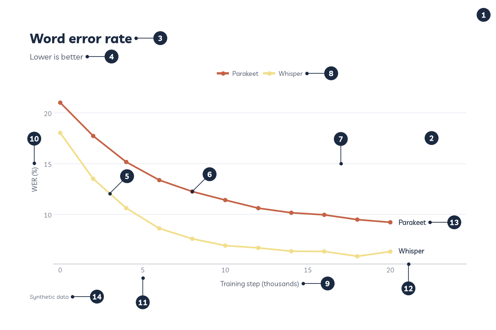

# Anatomy of a figure

Once you know what each part of a chart is called, it's much easier to change it, search the docs for it, or tell someone else what you'd like changed. matplotlib has a lovely [Anatomy of a figure](https://matplotlib.org/stable/gallery/showcase/anatomy.html) example that labels every part. This page does the same thing for plotnine and Roygbviz.

---

## The parts, numbered

This is an ordinary Roygbviz chart with its parts numbered. It has both a legend and end labels so you can see both. A real figure would use one or the other.

<picture>
  <source media="(prefers-color-scheme: dark)" srcset="assets/anatomy/anatomy_dark.png">
  
</picture>

**What the chart itself shows.** Two speech-to-text models learning. Going across is how far through training each one is, in thousands of steps. Going up is word error rate, the percentage of words the model gets wrong, so lower is better. Each dot is one measurement, and the line joins up one model's dots in order. Both lines fall, so both models improve with training. Whisper starts at about 18% and finishes at about 6%. Parakeet starts higher, at about 21%, and finishes at about 9%. Whisper's line drops faster early on and stays lower the whole way, so it learns quicker and ends up better.

A **series** is one set of values that belong together, like one model's results. This chart has two series, and most of the parts below exist to tell series apart or to read values off them.

The numbers match this table. The plotnine column gives the name you'd use to set or change that part, and the last column is what Roygbviz does with it.

| # | Part | plotnine | Roygbviz |
|---|---|---|---|
| 1 | **Figure.** The whole image, edge to edge. Everything else sits on it. | `figure_size`, or `width` and `height` in `save()`. Background: `plot_background` | The paper colour for your mode, with no border |
| 2 | **Panel.** The area where the data is drawn. matplotlib calls it the Axes. | `panel_background`, `panel_border` | The same colour as the paper, with no border, so the chart sits straight on the page |
| 3 | **Title.** The headline. In my figures it says what the chart shows. | `labs(title=...)`, `plot_title` | Livvic, bold, 1.6 times the text size, lined up with the left edge of the whole figure |
| 4 | **Subtitle.** A line under the title saying what's measured, or how to read it. | `labs(subtitle=...)`, `plot_subtitle` | Softer ink, a little smaller than body text |
| 5 | **Line.** Joins one series' values in order, so your eye can follow it. | `geom_line()` | Colour from the Roygbviz scale. Use `rv.stroke()` to size it with the text |
| 6 | **Markers.** A dot (or other shape) for each actual value. plotnine calls them points. | `geom_point()` | Same as lines |
| 7 | **Gridline.** A faint line that helps your eye carry a value across to the axis. | `panel_grid_major`, `panel_grid_minor` | Hairlines, horizontal only by default. No minor gridlines |
| 8 | **Legend.** The key that says which colour or shape means what. | Made for you from `aes()`. `legend_position`, `legend_title`, `legend_text` | No box, quiet title. I usually swap it for end labels |
| 9 | **x axis title.** Says what's measured going across, and in what units. | `labs(x=...)`, `axis_title_x` | Softer ink, a little smaller than body text |
| 10 | **y axis title.** Says what's measured going up, and in what units. | `labs(y=...)`, `axis_title_y` | Same as the x axis title |
| 11 | **Tick label.** The numbers along an axis that give it a scale. | `breaks=` and `labels=` in the scale, `axis_text` | Muted grey, 0.8 times the text size. The tick marks themselves are hidden |
| 12 | **Axis line.** The line the chart stands on. matplotlib calls it a spine. | `axis_line_x`, `axis_line_y` | Along the bottom only. No line up the left side |
| 13 | **End label.** A series' name, written where its line ends, so you don't need the legend. | Not part of plotnine | `rv.end_labels()`. Written in ink, not the line's colour, so pale colours stay readable |
| 14 | **Caption.** Small print at the bottom: where the data came from, and notes like "Synthetic data". | `labs(caption=...)`, `plot_caption` | Small, muted, bottom left. It's where "Synthetic data" and sources go |

One more part isn't in the picture: the **strip**, which is the label above each small panel when you use facets. plotnine calls it `strip_text`, and Roygbviz makes it bold with no background box. You can see strips in the [Grammar of graphics](grammar-of-graphics.md#build-a-chart-one-part-at-a-time) example.

---

## Coming from matplotlib

matplotlib's anatomy example labels sixteen parts. Here's where each one lives in plotnine:

| matplotlib label | matplotlib code | plotnine |
|---|---|---|
| Figure | `plt.figure` | The whole chart. Size it with `theme(figure_size=...)` |
| Axes | `fig.subplots` | The panel. You get one per facet |
| Title | `ax.set_title` | `labs(title=...)` |
| Line | `ax.plot` | `geom_line()` |
| Markers | `ax.scatter` | `geom_point()` |
| Grid | `ax.grid` | `panel_grid_major`, `panel_grid_minor` |
| Legend | `ax.legend` | Made from `aes()`. Move it with `legend_position` |
| x Axis, y Axis | `ax.xaxis`, `ax.yaxis` | The position scales, like `scale_x_continuous()` |
| xlabel, ylabel | `ax.set_xlabel`, `ax.set_ylabel` | `labs(x=..., y=...)` |
| Major tick | `ax.yaxis.set_major_locator` | `breaks=` in the scale. Drawn by `axis_ticks_major`, which Roygbviz hides |
| Major tick label | `ax.yaxis.set_major_formatter` | `labels=` in the scale, styled by `axis_text` |
| Minor tick | `ax.yaxis.set_minor_locator` | `minor_breaks=` in the scale. Drawn by `axis_ticks_minor`, which Roygbviz hides |
| Minor tick label | `ax.xaxis.set_minor_formatter` | No equivalent. plotnine only labels the major breaks |
| Spine | `ax.spines` | `axis_line_x`, `axis_line_y`, `panel_border` |

---

## Words that get mixed up

- **Axes and axis.** In matplotlib, the Axes is the whole plotting area. An axis is just the x or the y. plotnine avoids the confusion by calling the area a **panel**.
- **Figure, plot and chart.** The figure is the whole image. People use plot and chart loosely for the same thing.
- **Legend and key.** The legend is the whole box. Each little sample of a colour or shape inside it is a **key**. plotnine calls legends **guides**.
- **Axis title and tick labels.** The axis title names the whole axis ("Training step"). Tick labels are the numbers or categories along it.

---

## Changing a part

Every part in the plotnine column that isn't a function, like `plot_title` or `axis_ticks`, is a theme setting. You change it by adding `theme(...)` after the Roygbviz theme:

```python
from plotnine import element_line, element_text, theme

+ theme(plot_title=element_text(size=20))                   # a bigger title
+ theme(axis_ticks=element_line(colour=rv.colour("grey")))  # bring back tick marks
+ theme(legend_position="none")                             # hide the legend
```

Text parts take `element_text()`, lines take `element_line()`, boxes take `element_rect()`, and `element_blank()` hides any of them. [Customisation](customisation.md) and [Fonts and text](fonts-and-text.md) go further.

---

<small>The idea for this page, and the list of matplotlib parts, come from matplotlib's [Anatomy of a figure](https://matplotlib.org/stable/gallery/showcase/anatomy.html) example by the matplotlib development team. The chart and the descriptions here are my own. The figure script is [`scripts/anatomy.py`](https://github.com/KhaiShea/roygbviz-wiki/blob/main/scripts/anatomy.py).</small>
