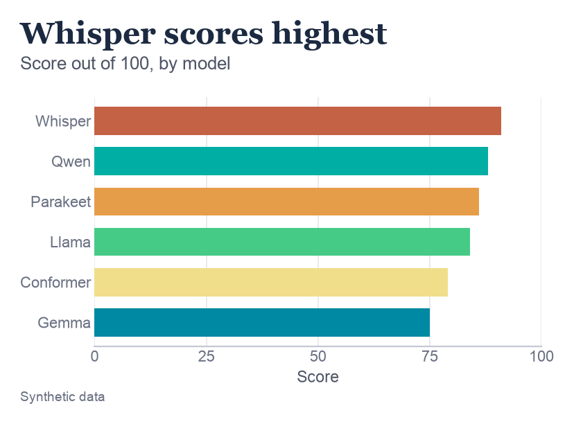
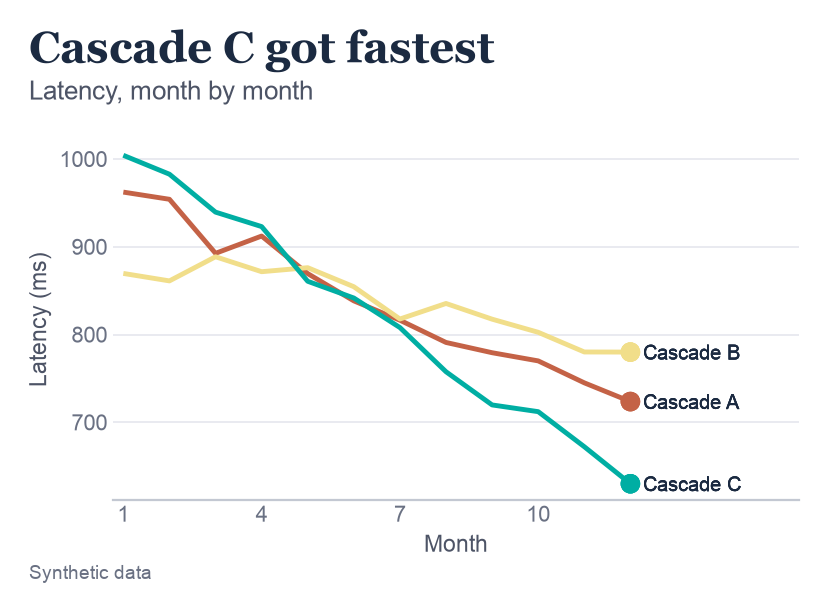
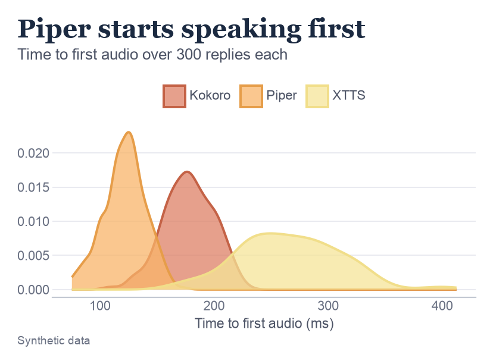
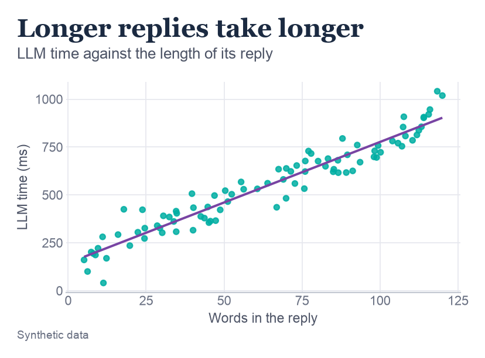
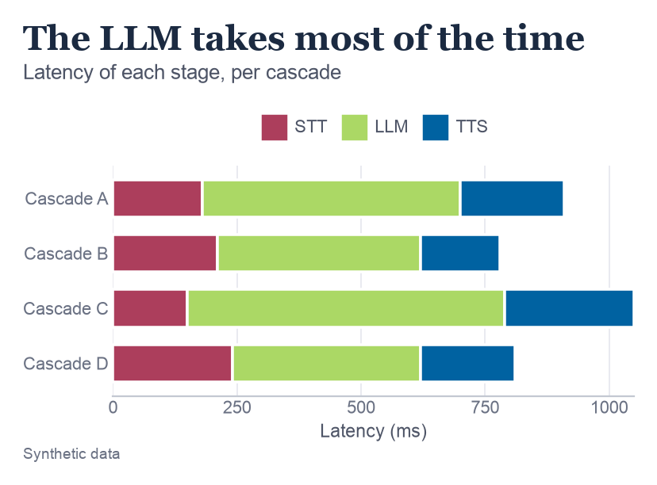
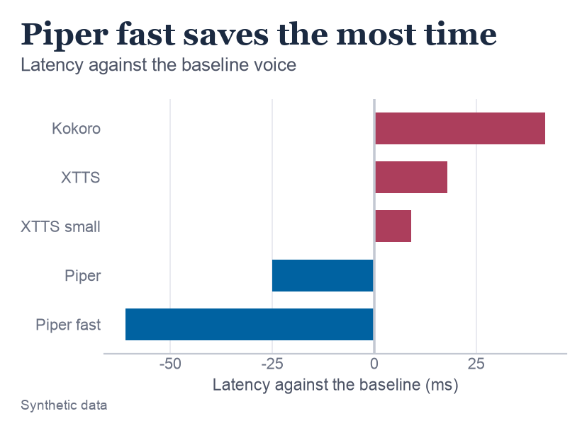
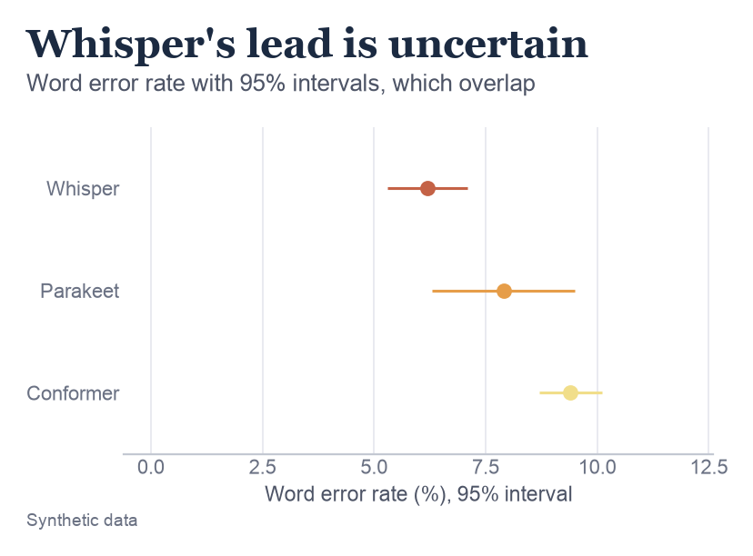
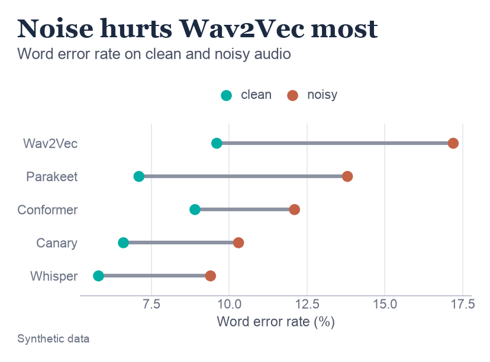
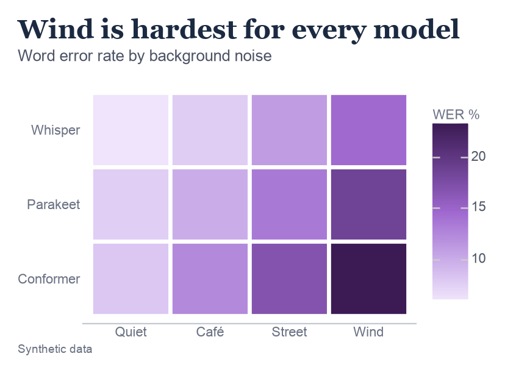

# Choosing a plot

Start from the question you're asking, not the chart you'd like to make. Find your question below, use the go-to chart, and read "when not to use it" before you commit. Most bad charts are good charts answering the wrong question.

A few terms first. The examples all come from speech pipelines, so two of them are about those:

- **Baseline.** The value you're measuring against. Often zero, sometimes a target or last year's model.
- **Distribution.** How a set of values is spread out: where most of them sit, and how far the rest stray.
- **Interval.** A range around an estimate that shows how sure you can be about it, like a 95% confidence interval.
- **Latency.** How long something takes, in milliseconds (ms). Lower is faster.
- **Word error rate (WER).** The percentage of words a speech-to-text model gets wrong. Lower is better.

---

## How to read any chart

If charts aren't your thing, these three steps get you most of the way with any of them:

1. **Read the title and subtitle.** In my figures, the title is the answer, so it tells you what to look for. The subtitle says what's being measured.
2. **Check the axes.** Work out what across and up stand for, what units they're in, and whether higher is better or worse. For latency and word error rate, lower is better.
3. **Find the extremes.** Look for the biggest, the smallest, and anything that breaks the pattern. That's usually where the story is.

Each section below then walks through its example chart, so you can see these steps in action.

---

## Before you pick

- **Write the question as a sentence.** "Which STT model makes the fewest mistakes?" If you can't write the sentence, the chart won't know what to say either.
- **One question per chart.** Two questions need two charts, or one chart split into panels with facets.
- **Use position before colour.** People judge lengths and positions along a shared axis far more accurately than shades of colour. Cleveland and McGill measured this in [Graphical Perception](https://doi.org/10.1080/01621459.1984.10478080) (1984). So put the comparison that matters most on an axis.
- **Make the title the answer.** "Whisper makes the fewest mistakes" tells a friend what to see. "Word error rate by model" makes them work it out.

---

## The nine questions

Find your question and jump to it. Each section shows the go-to chart, explains it, gives the code, and then says when not to use it. Each chart's title is the answer it gives, as suggested above.

| Question | Go-to chart | In plotnine | Don't use it when |
|---|---|---|---|
| [How do these compare?](#how-do-these-compare) | Bar chart, sorted | `geom_col()` | Zero isn't a meaningful start |
| [How has it changed?](#how-has-it-changed) | Line chart | `geom_line()` | The x axis has no order |
| [How is it spread out?](#how-is-it-spread-out) | Histogram, density or box plot | `geom_histogram()`, `geom_density()`, `geom_boxplot()` | You have fewer than about 20 values |
| [Are these related?](#are-these-related) | Scatter plot | `geom_point()` | Thousands of points pile up |
| [What is it made of?](#what-is-it-made-of) | Stacked bar | `geom_col()` | There are more than about five parts |
| [How far from the baseline?](#how-far-from-the-baseline) | Diverging bar | `geom_col()` and `geom_hline()` | There's no meaningful baseline |
| [How sure are we?](#how-sure-are-we) | Point and range | `geom_pointrange()` | Never swap it for bars with error bars |
| [What changed for each one?](#what-changed-for-each-one) | Dumbbell | `geom_segment()` and `geom_point()` | There are more than two time points |
| [How do two things combine?](#how-do-two-things-combine) | Heatmap | `geom_tile()` | Readers need the exact numbers |

---

## How do these compare?

<picture><source media="(prefers-color-scheme: dark)" srcset="assets/choosing/q1_dark.png"></picture>

**What it is.** A bar chart gives each thing its own bar, and the bar's length is its value. A longer bar means a bigger number. All the bars start from the same line, which makes them easy to compare.

**How to read this one.** Each bar is one model's score out of 100. Whisper's bar reaches furthest, at 91, so it scored highest. Gemma's is shortest, at 75. The bars are sorted, so reading down the chart is reading the ranking. The colours aren't needed to read it, but they mark which models are speech to text (warm colours) and which are language models (cool colours), the same as in every figure I make.

**Making it.** Sort the bars so the order does some of the work. Flip the chart on its side with `coord_flip()` when the names are long, so they can be read without tilting your head.

```python
order = d.sort_values("score")["model"]
d["model"] = pd.Categorical(d["model"], order)   # the bars follow this order

ggplot(d, aes("model", "score", fill="model")) + geom_col() + coord_flip()
```

**When not to use it:**

- **Zero isn't a meaningful start.** A bar's length is the value, so bars must start at zero. If all your scores sit between 80 and 95 and the small gaps matter, use a dot plot (`geom_point()`) on a narrower axis instead.
- **There are more than about 15 bars.** Switch to a sorted dot plot, or show the top few and fold the rest into "Other".
- **The values are averages with real spread.** A bar hides the spread. See [how sure are we?](#how-sure-are-we)

---

## How has it changed?

<picture><source media="(prefers-color-scheme: dark)" srcset="assets/choosing/q2_dark.png"></picture>

**What it is.** A line chart joins up values in order, usually over time, so you can follow each one as it rises and falls. Time runs left to right, and higher up means a bigger value.

**How to read this one.** Each line follows one cascade's latency (how long it takes to reply) over twelve months, so lower is better. Cascade B started fastest, at about 880 ms, but barely improved. Cascade C started slowest, at about 1,000 ms, then dropped steeply to about 630 ms and finished fastest. Where two lines cross, the ranking changed hands, which here happens around months five to seven.

**Making it.** Name each line at its end with `rv.end_labels()`, so nobody has to match colours against a legend.

```python
(ggplot(d, aes("month", "ms", colour="cascade"))
 + geom_line()
 + rv.end_labels(d, "month", "ms", "cascade") + rv.room())
```

**When not to use it:**

- **The x axis has no order.** Lines between categories like model names imply a path that isn't there. Use bars.
- **You only have two points in time.** Use a dumbbell or slope chart. See [what changed for each one?](#what-changed-for-each-one)
- **There are more than about five lines.** It turns into spaghetti. Split them into small panels with `facet_wrap()`, or draw the one that matters in colour and the rest in grey.

---

## How is it spread out?

<picture><source media="(prefers-color-scheme: dark)" srcset="assets/choosing/q3_dark.png"></picture>

**What it is.** A distribution chart shows how many values fall at each size, rather than a single average. Two models with the same average can behave very differently, and this is how you'd see it. A density curve is a smoothed-out histogram: wherever the curve is high, lots of values landed there.

**How to read this one.** Each curve is one voice model's time to first audio (how long until it starts speaking) over 300 replies. Piper's curve is a tall, narrow peak around 120 ms, so it's quick and very consistent. XTTS's is a low, wide hump, with most replies somewhere between about 190 and 330 ms, so it's slower and harder to predict. You can ignore the small numbers up the side. They're scaled so the area under each curve adds up to one, and it's the shape that matters.

**Making it.** Use a histogram for one group. To compare a few groups, use density curves or box plots, and a violin plot when there are several groups and their shape matters. For filled shapes, Roygbviz's rule is a fill one level lighter than the outline: `scale_fill_manual(values=rv.shade_map(colours))`.

```python
geom_histogram(bins=30)    # one group
geom_density()             # a few groups, overlaid
geom_boxplot()             # many groups, side by side
```

**When not to use it:**

- **You have fewer than about 20 values.** The shape is mostly noise. Show every value with `geom_jitter()` instead.
- **The data might have two humps.** A box plot hides that completely. Use a density or violin plot.
- **You've only tried one bin width.** A histogram's shape changes with `bins=`. Try a few before you trust it.

---

## Are these related?

<picture><source media="(prefers-color-scheme: dark)" srcset="assets/choosing/q4_dark.png"></picture>

**What it is.** A scatter plot puts one dot down for each observation, using one measurement for how far across and another for how far up. If the dots form a slope, the two measurements move together.

**How to read this one.** Each dot is one reply from a language model: how many words it had (across) and how long the model took to write it (up). The dots climb from bottom left to top right, so longer replies took longer. The purple line is the straight line that fits the dots best. Its slope works out at about 6.5 ms for every extra word. The dots stay close to the line, so it's a strong relationship.

**Making it.** Add `geom_smooth(method="lm")` if a straight trend is worth showing, and use `grid="xy"` so both axes get gridlines to read against.

```python
(ggplot(d, aes("words", "ms"))
 + geom_point()
 + geom_smooth(method="lm", se=False)
 + rv.theme_roygbviz(grid="xy"))
```

**When not to use it:**

- **Thousands of points pile up.** You can't see where most of them are. Use `geom_bin_2d()` to count points in squares, or make the points see-through with `alpha=0.2`.
- **One of the variables is time.** Use a line chart.
- **You want to show cause.** A line through the points shows the two move together, not that one causes the other. Say so in the text if it matters.

---

## What is it made of?

<picture><source media="(prefers-color-scheme: dark)" srcset="assets/choosing/q5_dark.png"></picture>

**What it is.** A stacked bar splits each total into its parts and stacks them end to end. The whole bar is the total, and each coloured piece is one part of it.

**How to read this one.** Each bar is one cascade's total latency, split into its three stages: speech to text (crimson), the language model (lime) and text to speech (deep blue). Where a bar ends is its total, so Cascade C is the slowest overall at about 1,050 ms. The width of each piece is how long that stage took. The lime piece is the widest in every bar, so the language model is where most of the time goes.

**Making it.** For the three stages of a cascade, Roygbviz has its own stage colours, so use `rv.scale_fill_roygbviz_groups()`. To show shares instead of totals, stack to 100% with `position="fill"`.

```python
(ggplot(d, aes("cascade", "ms", fill="stage"))
 + geom_col()
 + rv.scale_fill_roygbviz_groups())
```

**When not to use it:**

- **There are more than about five parts.** The thin middle slices become impossible to compare. Fold small parts into "Other".
- **You need to compare one middle part across bars.** Only the bottom part shares a baseline, so put the important part at the bottom, or put the parts side by side with `position="dodge"`.
- **You were going to use a pie chart.** See [charts I avoid](#charts-i-avoid).

---

## How far from the baseline?

<picture><source media="(prefers-color-scheme: dark)" srcset="assets/choosing/q6_dark.png"></picture>

**What it is.** A diverging bar chart starts every bar from a baseline in the middle. Bars on one side are above it, and bars on the other side are below it.

**How to read this one.** The middle line is the baseline voice. Each bar shows how much slower (to the right, in crimson) or faster (to the left, in blue) another voice was. Piper fast reaches about 60 ms to the left, so it saved the most time. Kokoro reaches about 40 ms to the right, so it added the most.

**Making it.** Roygbviz's diverging colours put crimson (hot) above the baseline and deep blue (cold) below. Where you can, pick the direction so crimson means worse, like slower here. For a grid of values rather than bars, use the diverging colour scale `rv.scale_fill_roygbviz_div()`.

```python
(ggplot(d, aes("model", "change", fill="sign"))
 + geom_col()
 + geom_hline(yintercept=0)
 + coord_flip())
```

**When not to use it:**

- **There's no meaningful baseline.** Then there's nothing to diverge from. Use plain bars.
- **The values are all positive, like counts.** A diverging colour scale invents a midpoint that means nothing. Use a single-colour scale like `rv.scale_fill_roygbviz_c()`.

---

## How sure are we?

<picture><source media="(prefers-color-scheme: dark)" srcset="assets/choosing/q7_dark.png"></picture>

**What it is.** A measurement from a sample of data is only an estimate. A point and range chart shows the estimate as a dot, and an interval as a line through it: the range the true value probably sits in. A shorter line means more certainty.

**How to read this one.** Each dot is a model's word error rate, which is the percentage of words it gets wrong, so lower is better. Whisper's dot is lowest at about 6%. But its line runs from about 5.3% to 7.1%, which overlaps Parakeet's (about 6.3% to 9.5%). With this much data, I'd be careful claiming Whisper beats Parakeet. Whisper's and Conformer's lines don't overlap at all, so that difference is much safer to trust.

**Making it.** Use `geom_pointrange()`. Along a line chart, use a shaded band with `geom_ribbon()` and `rv.shade()` for the fill instead. Always say what the range is (a 95% interval, one standard deviation, or lowest to highest) in an axis title or the caption, because they mean very different things.

```python
(ggplot(d, aes("model", "wer", ymin="low", ymax="high"))
 + geom_pointrange()
 + coord_flip())
```

**When not to use it:**

- **Never swap it for bars with error bars.** The bar suggests everything from zero up is part of the value, and it hides the actual data. Use the point and range, or show every value.
- **There are only a handful of observations.** Show the raw points with `geom_jitter()` as well, so readers can see how little there is.

---

## What changed for each one?

<picture><source media="(prefers-color-scheme: dark)" srcset="assets/choosing/q8_dark.png"></picture>

**What it is.** A dumbbell chart shows two values for each item, as two dots joined by a bar. The length of the bar is how much changed.

**How to read this one.** Each row is one speech-to-text model. The teal dot is its word error rate on clean audio, and the red dot is the same on noisy audio. The grey bar between them is the damage the noise did, so a longer bar means a bigger hit. Wav2Vec's bar is the longest, from about 9.6% to 17.2%, so noise hurt it most. Conformer's is the shortest, so it copes with noise best, even though Whisper is still lowest in both conditions.

**Making it.** Join the two values with `geom_segment()` and mark the ends with `geom_point()`. Use a slope chart (lines between two columns) instead when the change in ranking matters most.

```python
# d has one row per model; long has one row per model and audio type
(ggplot(d)
 + geom_segment(aes(x="clean", xend="noisy", y="model", yend="model"))
 + geom_point(aes("wer", "model", colour="audio"), data=long))
```

**When not to use it:**

- **There are more than two points in time.** Use a line chart.
- **There are many items and the changes are small.** The dots overlap. Plot the change itself as a [diverging bar](#how-far-from-the-baseline).

---

## How do two things combine?

<picture><source media="(prefers-color-scheme: dark)" srcset="assets/choosing/q9_dark.png"></picture>

**What it is.** A heatmap is a grid of coloured squares, one for every combination of two things. Instead of reading numbers, you look for where the colour is strongest.

**How to read this one.** Each row is a speech-to-text model and each column is a kind of background noise. The further a square's colour is from the background, the higher its word error rate, and the key on the right shows the scale. Read along a row to see how one model copes as the noise gets harder. Read down a column to compare the models in the same noise. The wind column stands out for every model, and Conformer in wind is the worst of all, at about 23%.

**Making it.** Use a single-colour scale like `rv.scale_fill_roygbviz_c("violet")` for amounts, or the diverging scale when there's a midpoint. A grid of three STT models against three LLMs is exactly this shape.

```python
(ggplot(d, aes("noise", "model", fill="wer"))
 + geom_tile()
 + rv.scale_fill_roygbviz_c("violet"))
```

**When not to use it:**

- **Readers need the exact numbers.** Colour is the least precise way to read a value. Write the numbers on the tiles with `geom_text()`, or use a table.
- **There are only a few combinations.** Grouped bars (`position="dodge"`) are easier to read than four coloured squares.

---

## Charts I avoid

- **Pie charts.** People are bad at comparing angles, so a stacked bar or a sorted bar says the same thing more clearly. plotnine can't draw pies anyway, because it has no polar coordinates.
- **Two y axes on one chart.** You choose both scales, so you can make any two lines look related. Use two panels, one above the other, with a shared x axis.
- **3D effects on flat data.** The perspective makes nearer bars look bigger than they are.

---

## When there's too much

Roygbviz has nine model colours, and the usual advice is to stop well before that. When there are more groups than colours:

- **Facet it.** One small panel per group with `facet_wrap()`. Every panel can then use the same colours.
- **Highlight one.** Draw what matters in colour and everything else in grey. `rv.colour_map()` gives any group called `"Other"` the neutral grey.
- **Fold the tail.** Keep the top few and combine the rest into "Other".

The [plot type reference](plot-types/index.md) has a full page for each kind of chart, with code and light and dark output. The figures on this page are made by [`scripts/choosing.py`](https://github.com/KhaiShea/roygbviz-wiki/blob/main/scripts/choosing.py).
