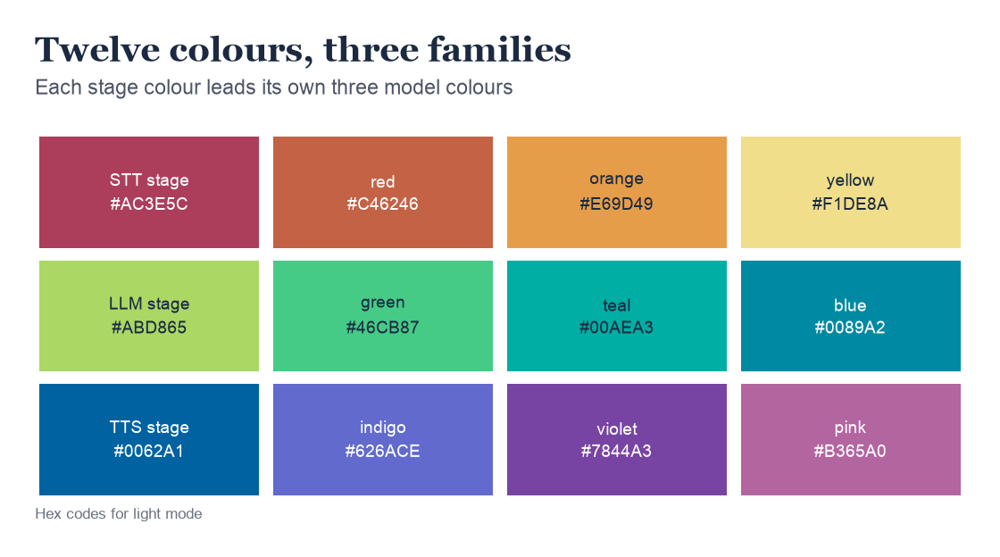
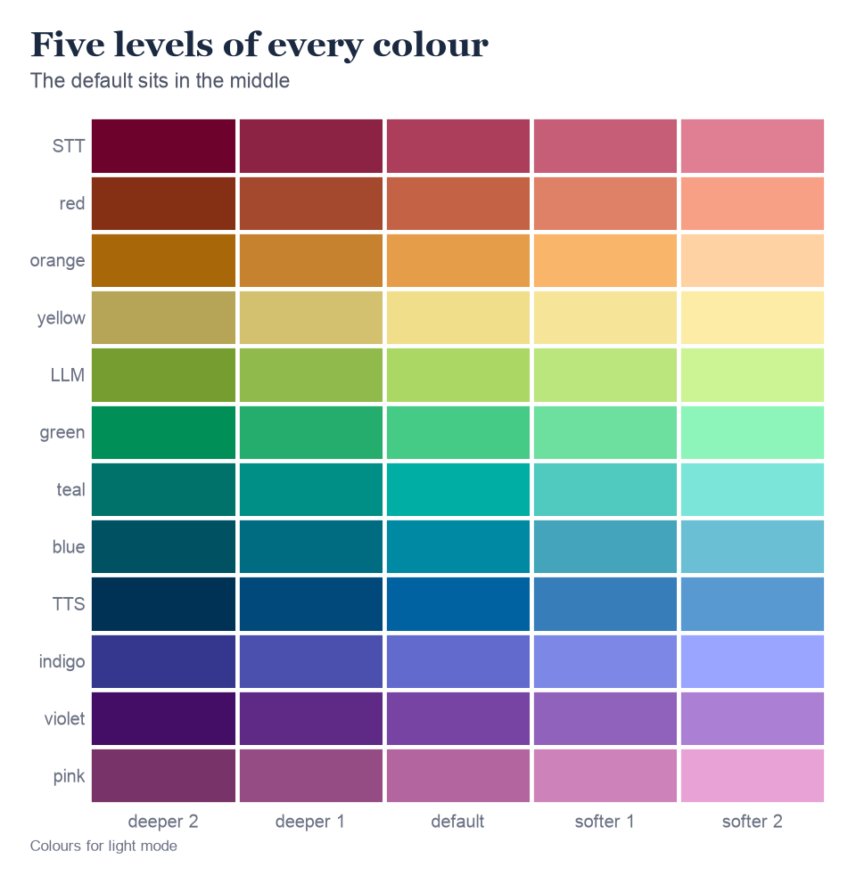
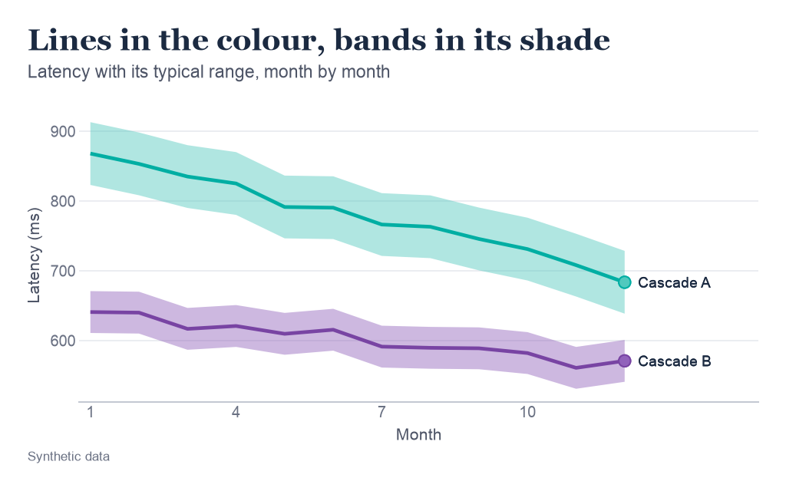
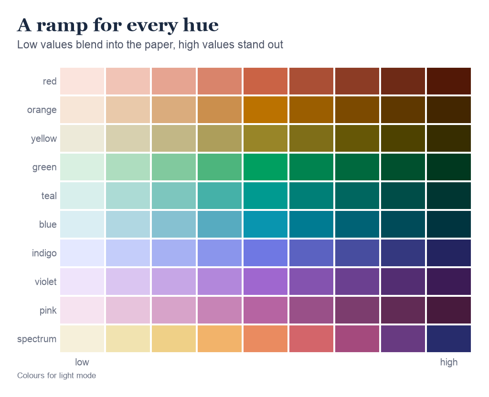
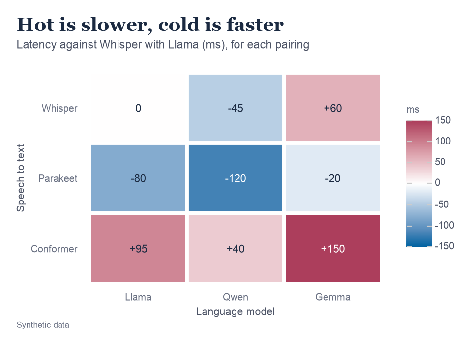
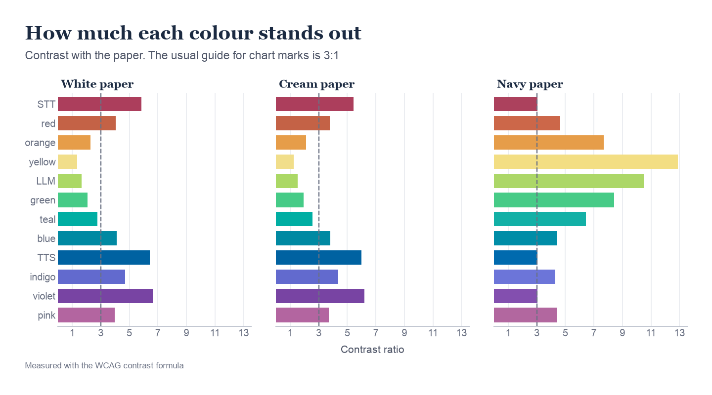
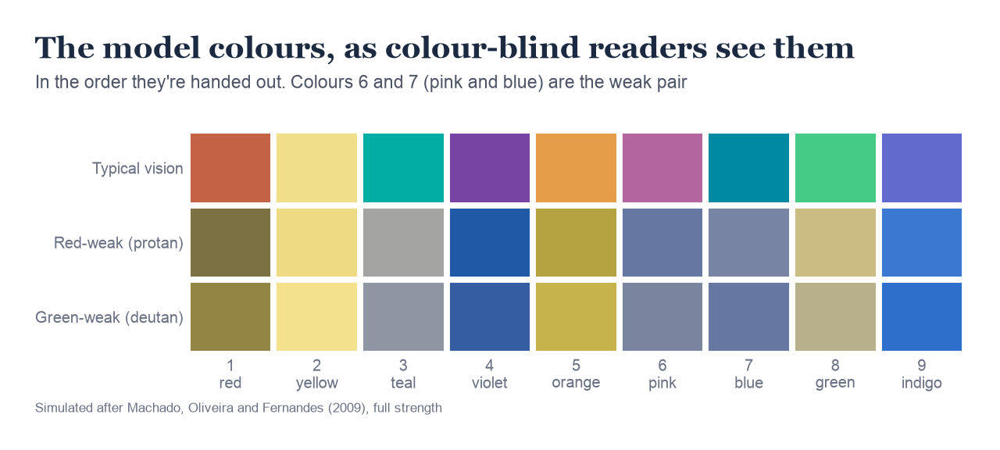

# Colour

Colour is the part of Roygbviz people notice first, and the part I spent longest on. This page covers every colour in it: what each one is for, how to use it, and where it falls short.

A few terms first:

- **Hue.** Which colour it is: red, yellow, blue and so on.
- **Lightness.** How close a colour is to white or to black.
- **Chroma.** How colourful it is, from grey to vivid.
- **OKLCH.** A way of describing a colour by its lightness, chroma and hue, built so that equal steps look equally different to people. I tuned the palette in it.
- **Hex code.** The six-character code computers use for a colour, like `#C46246`.
- **Contrast ratio.** How much a colour stands out from what's behind it, from 1:1 (invisible) up to 21:1 (black on white).

---

## Which scale do I need?

A **scale** is the rule that turns your data into colours. Pick the row that matches what you're drawing:

| You're showing | Use |
|---|---|
| Groups, as lines or points | `rv.scale_colour_roygbviz_d()` |
| Groups, as bars or areas | `rv.scale_fill_roygbviz_d()` |
| The three stages: STT, LLM and TTS | `rv.scale_colour_roygbviz_groups()` or `rv.scale_fill_roygbviz_groups()` |
| An amount, like a heatmap | `rv.scale_fill_roygbviz_c("violet")` |
| Above or below a midpoint | `rv.scale_fill_roygbviz_div()` |
| Each model in the same colour in every figure | `scale_colour_manual(values=rv.colour_map(models))` |

The `_d` scales are for separate groups (discrete), `_c` for amounts on a sliding scale (continuous), and `_div` for values that diverge either side of a midpoint. Every colour scale has a `fill` version for shapes with an inside, like bars, and a `colour` version for lines and points.

---

## The twelve colours

<picture>
  <source media="(prefers-color-scheme: dark)" srcset="assets/colour/palette_dark.png">
  
</picture>

**What they are.** Twelve colours spaced evenly round a rainbow, 30 degrees apart. Nine are for models (or any groups), and three are for the stages of a speech pipeline. Each stage colour sits next to its own three model colours on the wheel, so a stage and its models look like a family.

**How to read this one.** Each row is a family. The first swatch is the stage colour, and the next three are the model colours that go with it. Speech to text (STT) gets the warm colours, the language model (LLM) the greens and blues, and text to speech (TTS) the purples and pink. The hex codes are for whichever mode you're viewing this page in. Dark mode uses the same hues, with only the lightness moved.

**Where they came from.** I built them from Kate Morley's article [A 12-bit rainbow palette](https://iamkate.com/data/12-bit-rainbow/). A plain rainbow looks uneven, because our eyes see some hues as much brighter than others. Her fix is to let the lightness vary on purpose, peaking at yellow, because yellow only looks yellow when it's bright. I borrowed that idea rather than her colours, worked in OKLCH, and then nudged each colour until the closest pair was far enough apart.

| Name | Light and cream | Dark |
|---|---|---|
| STT stage | `#AC3E5C` | `#AC415D` |
| red | `#C46246` | `#CC6749` |
| orange | `#E69D49` | `#E69D49` |
| yellow | `#F1DE8A` | `#F3DE83` |
| LLM stage | `#ABD865` | `#ACD768` |
| green | `#46CB87` | `#47CB87` |
| teal | `#00AEA3` | `#13B0A6` |
| blue | `#0089A2` | `#008DA7` |
| TTS stage | `#0062A1` | `#006AAE` |
| indigo | `#626ACE` | `#6C75D9` |
| violet | `#7844A3` | `#834FAF` |
| pink | `#B365A0` | `#B2679F` |
| grey, for "Other" | `#8C92A1` (cream `#8E897C`) | `#8A90A0` |

```python
rv.colour("teal")    # one colour, for the current mode
rv.colour("STT")     # stage colours work too
rv.colour("grey")    # the neutral grey
```

---

## Which colour comes first

**What it does.** When you use `rv.scale_colour_roygbviz_d()`, colours are handed out in a fixed order: red, yellow, teal, violet, orange, pink, blue, green, indigo. Each new colour is the one furthest from the colours already used. So whether a chart has two series or five, they're as easy to tell apart as they can be.

**Pinning colours.** The catch is that the colours follow the order of the groups in each chart, so a model could be red in one figure and teal in the next. For a paper, pin each model to a colour once with `rv.colour_map()`, and use that same map everywhere. Add `order="rainbow"` and the colours follow the families above instead (red, orange, yellow, green and so on), which is how I get STT models in warm colours and LLMs in cool ones.

```python
MODELS = ["Whisper", "Parakeet", "Conformer", "Llama", "Qwen", "Gemma", "Other"]
COL = rv.colour_map(MODELS, order="rainbow")   # "Other" gets grey and doesn't use up a colour

... + scale_colour_manual(values=COL)
... + rv.scale_fill_roygbviz_groups()          # STT, LLM and TTS in their stage colours
```

**Be careful with:** more than nine groups. `rv.colour_map()` stops with `Roygbviz has nine series colours`. Fold the smallest groups into "Other", or split the chart into panels.

---

## Levels

<picture>
  <source media="(prefers-color-scheme: dark)" srcset="assets/colour/levels_dark.png">
  
</picture>

**What they are.** Every one of the twelve comes in five levels of lightness, from deep to soft. The default colour is the middle one.

**How to read this one.** Each row is one colour, and the middle column is the colour you normally get. Going left, each step is a little deeper, and going right, a little softer. Pale colours like yellow take smaller steps, so their softest levels don't fade to white.

**Using them.** Levels are for shades of the same thing: one model's settings, say, or the parts of a stacked bar that all belong to one stage. They're also the fix for thin lines that are too faint. `level=-1` moves every colour in a scale one step deeper.

```python
rv.levels("green", 5)                        # five levels, deepest first
rv.levels("STT", 3)                          # stage colours work too
rv.scale_colour_roygbviz_d(level=-1)         # every colour one step deeper
```

You can ask for 3, 5 or 7 levels. With 7, the softest yellows can come out almost white, so 3 or 5 is safer.

---

## Shading

<picture>
  <source media="(prefers-color-scheme: dark)" srcset="assets/colour/shading_dark.png">
  
</picture>

**What it is.** When a shape has both an outline and an inside (an area, a band, a bar), the outline keeps the default colour and the inside uses its **shade**, one level lighter. The shade reads as the same colour, just softer, so the edge stays crisp.

**How to read this one.** Each line is one cascade's latency, month by month. The band around it shows the typical range, from a bit faster to a bit slower. Each band is drawn in the shade of its line's colour, so it's obvious which band belongs to which line. Cascade A is slower but improving. Cascade B is faster and steadier, with a narrower band.

**Using it.** `rv.shade()` gives you the shade of one colour, and `rv.shade_map()` does a whole colour map at once. In dark mode, "lighter" means brighter, so a shaded band can drown out its line. Make bands see-through with `alpha`.

```python
cols = {"Cascade A": rv.colour("teal"), "Cascade B": rv.colour("violet")}

(ggplot(d, aes("month", "ms", colour="cascade", fill="cascade"))
 + geom_ribbon(aes(ymin="low", ymax="high"), colour="none", alpha=0.45)
 + geom_line()
 + scale_colour_manual(values=cols)
 + scale_fill_manual(values=rv.shade_map(cols)))
```

---

## Amounts: one-colour ramps

<picture>
  <source media="(prefers-color-scheme: dark)" srcset="assets/colour/ramps_dark.png">
  
</picture>

**What it is.** A **sequential** scale shows an amount, like a count or an error rate, as a ramp from faint to strong. Low values blend into the paper, and high values stand out.

**How to read this one.** Each row is one ramp, from low on the left to high on the right. There's one for each of the nine model colours, plus a "spectrum" ramp that moves through several hues for when you need more steps to tell apart. In dark mode the ramps run the other way, from navy up to bright, so high values still stand out from the paper.

**Using it.** Pass the name of any of the nine colours, or `"spectrum"`. The default is blue.

```python
rv.scale_fill_roygbviz_c("violet")    # a heatmap of amounts
rv.scale_colour_roygbviz_c()          # points coloured by an amount, in blue
```

**Don't use it when** the data has a meaningful middle, like change against a baseline. Use the diverging scale below instead.

---

## Above and below: the diverging scale

<picture>
  <source media="(prefers-color-scheme: dark)" srcset="assets/colour/diverging_dark.png">
  
</picture>

**What it is.** A **diverging** scale has a midpoint, and colours that grow stronger either way from it. In Roygbviz, above the midpoint runs to crimson (the STT colour, hot), below runs to deep blue (the TTS colour, cold), and the midpoint is white. In dark mode the midpoint is a soft cream-white (`#F3EEE3`) so it doesn't glare.

**How to read this one.** Each row is a speech-to-text model and each column a language model, so each square is one pairing. The number is how much slower (+) or faster (-) that pairing is than Whisper with Llama, which is the white 0 in the corner. Conformer with Gemma is the slowest, at 150 ms slower. Parakeet with Qwen is the fastest, at 120 ms faster. The stronger the colour, the bigger the difference.

**Using it.** The scale centres on zero unless you pass `midpoint=`. Write numbers on the squares if readers need them. Use dark text on the pale squares and white on the strong ones, and pick whichever reads better.

```python
(ggplot(d, aes("llm", "stt", fill="change"))
 + geom_tile()
 + geom_text(aes(label="label"))
 + rv.scale_fill_roygbviz_div(limits=(-150, 150)))
```

**Be careful with:** which way round "above" is. Crimson tends to read as bad, so where you can, set things up so that above the midpoint means worse, like slower here.

---

## Contrast

<picture>
  <source media="(prefers-color-scheme: dark)" srcset="assets/colour/contrast_dark.png">
  
</picture>

**What it is.** Contrast is how much a colour stands out from the paper behind it. The accessibility guidelines for the web ([WCAG](https://www.w3.org/TR/WCAG21/#non-text-contrast)) ask for at least 3:1 for the parts of a chart people need to see.

**How to read this one.** Each panel is one paper, and each bar is one colour's contrast against it. Bars that cross the dashed line pass 3:1. On white, five fall short: yellow (1.35:1), the LLM stage colour (1.65:1), green (2.07:1), orange (2.26:1) and teal (2.77:1). Cream is a little lower across the board. On navy, every colour passes, though violet and the STT and TTS stage colours only just do.

**Why I accept it.** The pale colours are pale on purpose, because yellow only looks yellow when it's bright. So instead of darkening them, I make sure colour is never the only way to read a chart:

1. **Name lines with `rv.end_labels()`.** The names are written in ink, not the line's colour, so they're always readable.
2. **Use `level=-1` for thin lines.** One step deeper is enough to lift most of them.
3. **Outline pale fills.** A bar filled with a pale colour and outlined one level deeper still has a clear edge.

To check any list of colours against the same rules Roygbviz was built to pass:

```python
print(rv.check(rv.get_palette("light").series(), "light"))
# lightness band outside (info) | chroma ok | CVD min 4.5 (info) | normal min 10.8 (>= 10)
# | contrast min 1.35 (>= 3) | below 3:1: #F1DE8A, #00AEA3, #E69D49, #46CB87
```

"Normal min" is how far apart the two closest colours are, for typical colour vision. The library needs at least 10, and the closest pair (indigo and violet in light mode, green and teal in dark) sits just above that. "CVD min" is the same for colour-blind readers, which the next section is about.

---

## Colour-blind readers

<picture>
  <source media="(prefers-color-scheme: dark)" srcset="assets/colour/colourblind_dark.png">
  
</picture>

**The status.** There's no colour-blind-safe set yet. `colourblind=True` stops with `NotImplementedError`. It's on my list, and I'd rather say so plainly than claim the palette is safe.

**Why it matters.** Red-green colour blindness is common. Birch's review of [worldwide prevalence](https://doi.org/10.1364/JOSAA.29.000313) puts it at about 8% of men and 0.4% of women of European descent, and between 4% and 6.5% of men of Chinese and Japanese descent. In a room of fifty people, you can expect a few.

**How to read this one.** The top row is the nine model colours in the order they're handed out. The two rows below show how they'd look to someone with strong red-weak (protan) or green-weak (deutan) colour vision, simulated with the method from [Machado, Oliveira and Fernandes (2009)](https://doi.org/10.1109/TVCG.2009.113). Red, orange and green all drift towards olive and khaki. Worst of all, pink (6) and blue (7) end up as almost the same greyish blue.

**What I do in the meantime.** The first five colours stay well apart even in the simulation, at a distance of about 12 against the library's target of 8. Adding the sixth (pink) drops that to about 6, and the seventh (blue) to 4.5. So:

1. **Keep to five series where you can.** Fold the rest into "Other", or split into panels.
2. **Never rely on colour alone.** Name lines directly, so the colour is a second clue rather than the only one.
3. **Add a shape or a line style.** Mapping the same column to `shape` or `linetype` gives every reader something besides colour.

```python
(ggplot(d, aes("step", "wer", colour="model", shape="model"))
 + geom_line()
 + geom_point(size=3)
 + rv.scale_colour_roygbviz_d())
```

---

## Using the colours in your own code

All of these follow the mode that `rv.use()` last set:

```python
rv.colour("violet")             # one hex code
rv.colour_map(names)            # {name: hex}, pinned for every figure
rv.group_map()                  # {"STT": ..., "LLM": ..., "TTS": ...}
rv.levels("teal", 5)            # five levels, deepest first
rv.shade("teal")                # one level lighter, for fills
rv.cmap("violet")               # a matplotlib colormap
```

**The one trap.** `rv.get_palette()` doesn't follow `rv.use()`. With no arguments it always gives you the light palette, even in dark mode. Pass the mode, or keep the palette that `rv.use()` hands back:

```python
pal = rv.use("dark")             # rv.use() returns the palette it set
pal.neutrals["bg"]               # the navy paper colour
rv.get_palette("dark").groups    # or ask for the mode by name
```

**For plain matplotlib,** `rv.use()` also sets the colour cycle to the series order, and registers three colormaps you can use by name: `roygbviz` (the blue ramp, and the default for images), `roygbviz_spectrum` and `roygbviz_div`.

---

<small>The figures on this page are made by [`scripts/colour.py`](https://github.com/KhaiShea/roygbviz-wiki/blob/main/scripts/colour.py). The palette's approach comes from Kate Morley's [12-bit rainbow](https://iamkate.com/data/12-bit-rainbow/), and the colour maths from Björn Ottosson's [OKLab](https://bottosson.github.io/posts/oklab/).</small>
