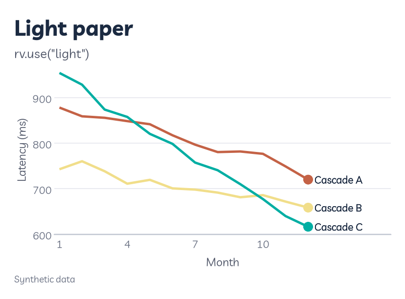
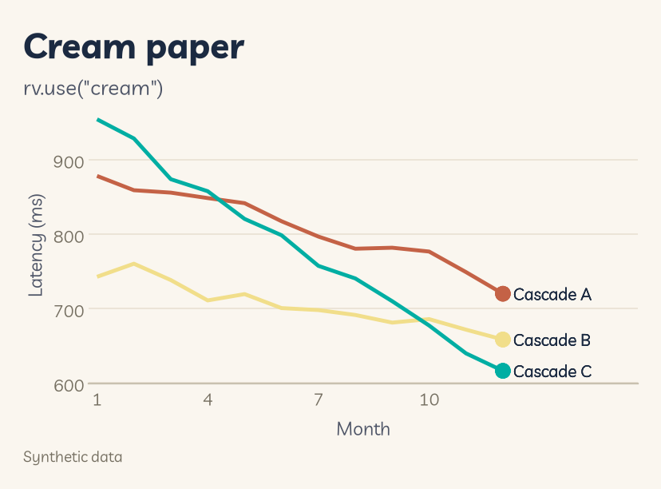
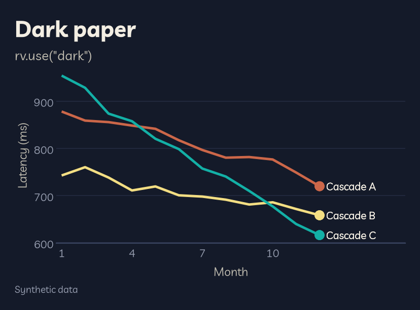
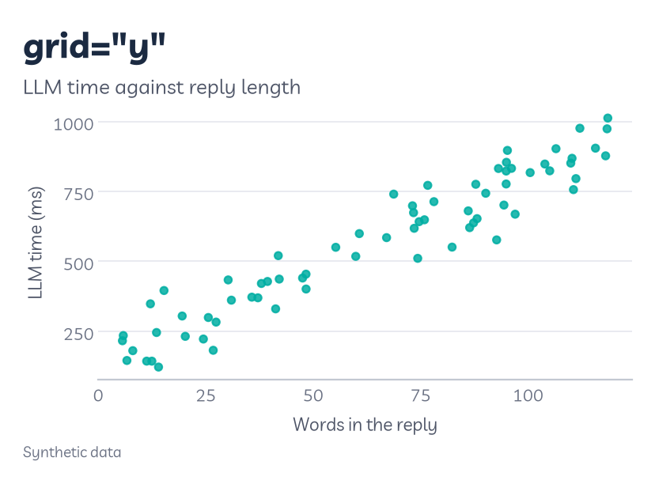
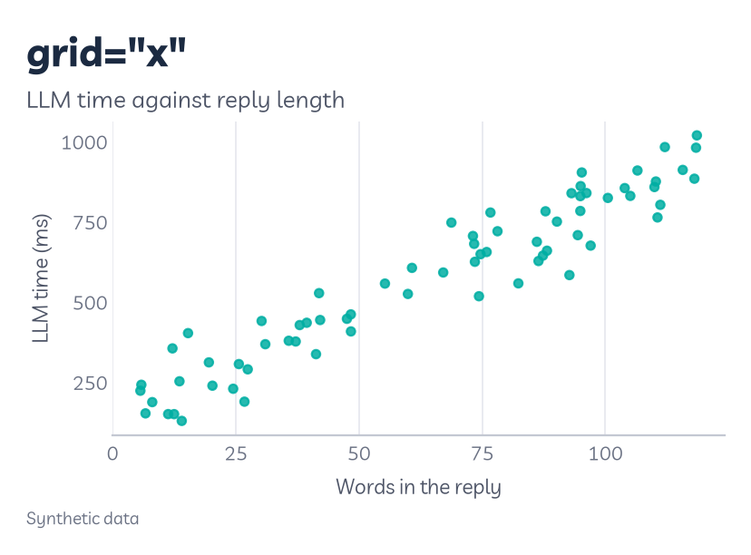
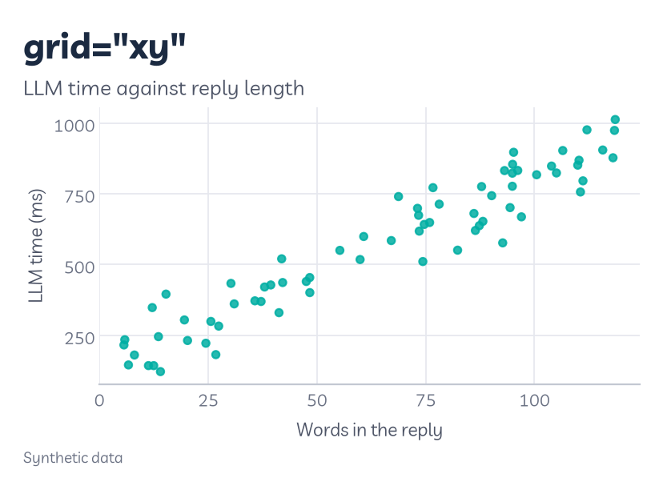
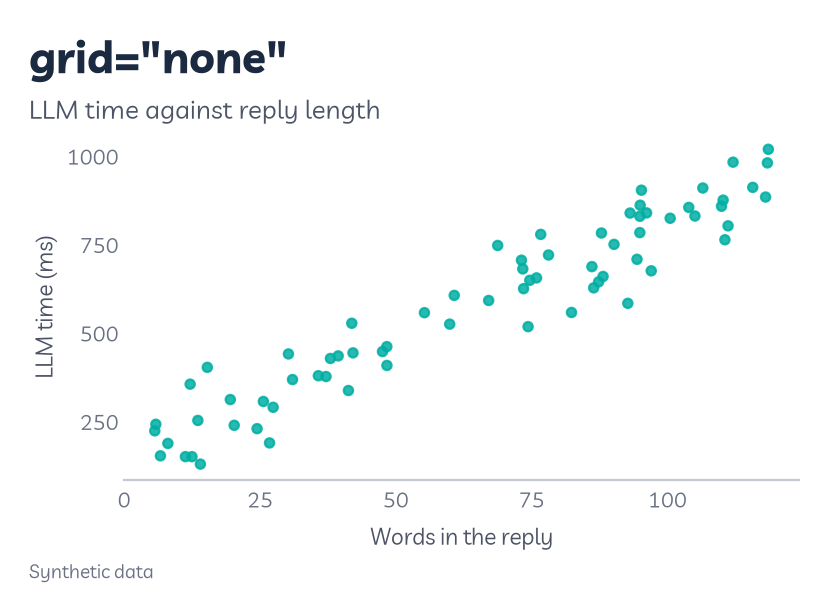
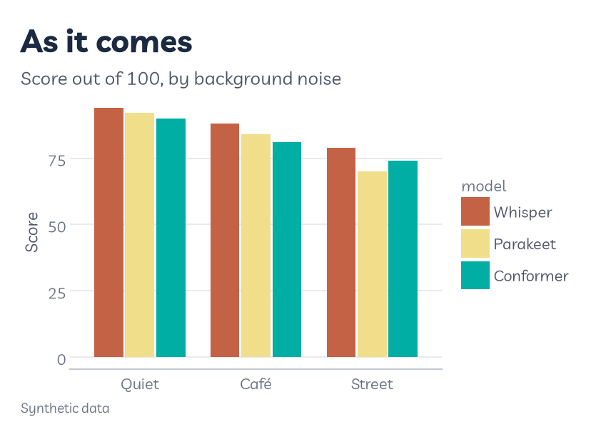
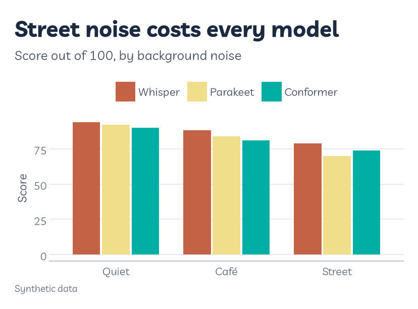
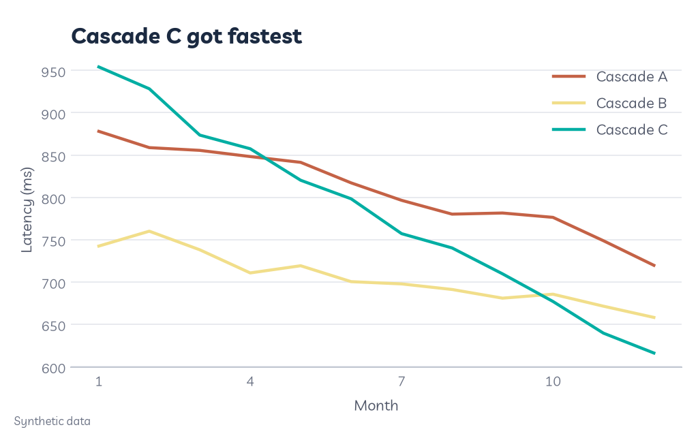

# Customisation

Roygbviz is meant to look right without any changes, but every chart is different. This page covers what you can change and where to change it.

There are three places to make a change, from broadest to narrowest:

- **`rv.use()`** sets things for every chart in the session: the paper, the text size, the gridlines.
- **`rv.theme_roygbviz()`** or **`rv.roygbviz()`** sets them for one chart.
- **`theme()`** changes one detail of one chart, like where the legend goes.

---

## The settings in `rv.use()`

| Setting | Does | Default |
|---|---|---|
| `mode` | The paper: `"light"`, `"cream"` or `"dark"` | `"light"` |
| `base_size` | The text size everything else is worked out from, in points | `11` |
| `grid` | Which gridlines to draw: `"y"`, `"x"`, `"xy"` or `"none"` | `"y"` |
| `order` | The order colours are handed out: `"series"` or `"rainbow"` | `"series"` |
| `plotnine` | Set plotnine's theme as well as matplotlib's | `True` |
| `colourblind` | Not built yet, and `True` stops with an error | `False` |

```python
rv.use("cream", base_size=12, grid="xy")
```

The [Colour page](colour.md#which-colour-comes-first) covers `order`, and [Fonts and text](fonts-and-text.md#text-size) covers `base_size`.

---

## Paper: light, cream or dark

<div class="figure-grid">



</div>

**What it is.** The **mode** sets the colour of the paper and everything that goes with it: the text, the gridlines and the axis line. The data colours stay the same, apart from small changes in dark mode so they hold up on navy.

**How to read this one.** One chart on each paper. These three don't change with this page's theme switch, since showing each mode is the point.

**Which to pick.**

- **Light** (white) for papers, reports and anything printed. It's the default.
- **Cream** (`#FAF6EF`) for slides or a website with a warm background. It was the original Roygbviz paper.
- **Dark** (navy, `#141A29`) for dark slides or a website with a dark mode. Every colour clears 3:1 contrast on navy, so it's the most readable of the three for the pale colours.

```python
rv.use("dark")
```

**Be careful with:** cream in print. A tinted background can look like a mistake on a white page, and it costs ink.

---

## Gridlines

<div class="figure-grid cols-2">
<picture><source media="(prefers-color-scheme: dark)" srcset="assets/customisation/grid_y_dark.png"></picture>
<picture><source media="(prefers-color-scheme: dark)" srcset="assets/customisation/grid_x_dark.png"></picture>
<picture><source media="(prefers-color-scheme: dark)" srcset="assets/customisation/grid_xy_dark.png"></picture>
<picture><source media="(prefers-color-scheme: dark)" srcset="assets/customisation/grid_none_dark.png"></picture>
</div>

**What they are.** Faint lines across the chart that help you read a value off the axis. Roygbviz draws them as thin as it can, so they help without getting in the way.

**How to read this one.** The same scatter plot four times, one per setting. Each dot is one reply from a language model: how many words it had, and how long it took. Try reading off the time for a 100-word reply in each. It's easiest with horizontal lines (`"y"` and `"xy"`), and guesswork with none.

**Which to pick.**

- **`"y"`**, the default, for most charts where the value goes up the side: lines, columns.
- **`"x"`** for horizontal bars, where the value goes along the bottom.
- **`"xy"`** for scatter plots, where both positions matter.
- **`"none"`** for heatmaps and charts with a label on every mark, where the lines add nothing.

```python
rv.use("light", grid="xy")         # for the whole session
... + rv.theme_roygbviz(grid="x")  # for one chart
```

---

## One chart, different settings

For a single chart that's different from the rest, add a theme to that chart instead of changing the session:

```python
... + rv.theme_roygbviz(grid="x")             # just the theme
... + rv.roygbviz("dark", aesthetics="fill")  # theme and colour scale
```

`rv.roygbviz()` bundles the theme and the matching colour scale. Pass `aesthetics="colour"` for lines and points, `"fill"` for bars and areas, or `"both"`.

**Be careful with:** the base size. `rv.theme_roygbviz()` and `rv.roygbviz()` start from 11 pt, whatever you set in `rv.use()`. If you changed it there, pass `base_size=` here too.

---

## Small changes with `theme()`

<div class="figure-grid cols-2">
<picture><source media="(prefers-color-scheme: dark)" srcset="assets/customisation/tweak_before_dark.png"></picture>
<picture><source media="(prefers-color-scheme: dark)" srcset="assets/customisation/tweak_after_dark.png"></picture>
</div>

**What it is.** plotnine's `theme()` changes one part of the look and leaves the rest alone. It's how you make the small fixes a particular chart needs.

**How to read this one.** Each group of bars is a background noise, and each bar a speech-to-text model's score out of 100. On the left is the chart as it comes. On the right, the legend has moved to a row along the top, where it takes no width from the bars, and its title ("model", the column name) is gone, since the names explain themselves. The title also now says what the chart shows: every model scores lowest with street noise.

```python
(ggplot(d, aes("noise", "score", fill="model"))
 + geom_col(position=position_dodge(0.8), width=0.75)
 + rv.scale_fill_roygbviz_d()
 + theme(legend_position="top", legend_title=element_blank()))
```

Some changes I make often:

| To | Add |
|---|---|
| Move the legend to the top, or hide it | `theme(legend_position="top")` or `theme(legend_position="none")` |
| Drop the legend's title | `theme(legend_title=element_blank())` |
| Slant long labels on the x axis | `theme(axis_text_x=element_text(rotation=45, ha="right"))` |
| Leave a gap under the subtitle | `theme(plot_subtitle=element_text(margin={"b": 10, "unit": "pt"}))` |
| Make the title bigger | `theme(plot_title=element_text(size=20))` |

**Be careful with:** order. `theme()` has to come after `rv.theme_roygbviz()`, because a full theme replaces every tweak before it. The [Grammar of graphics](grammar-of-graphics.md#the-order-of-the-pieces) page shows why.

---

## Saving

**What it does.** `.save()` writes the chart to a file. The file type comes from the name you give it.

```python
p.save("latency.png", width=6.4, height=4, dpi=300)   # a picture, for slides and the web
p.save("latency.pdf", width=6.4, height=4)            # for papers: sharp at any zoom
p.save("latency.svg", width=6.4, height=4)            # for websites, and editing in Inkscape or Illustrator
```

- **Width and height** are in inches. Save at the size the chart will be printed, so the text comes out the size you meant.
- **`dpi`** is dots per inch, and only matters for PNG. 300 is the usual ask for print, and 150 is plenty for a screen.
- **PDF and SVG** are made of shapes rather than dots, so they stay sharp however far you zoom in. Journals often ask for them.

**Light and dark versions.** For a GitHub README or a website with a dark mode, I save every chart twice. Build the chart after `rv.use()`, inside the loop, because a chart keeps the mode that was active when it was built:

```python
for mode in ("light", "dark"):
    rv.use(mode)
    make_chart().save(f"latency_{mode}.png", width=6.4, height=4, dpi=200)
```

Then a `<picture>` tag shows whichever suits the reader. GitHub and most browsers support it, and it's what this wiki uses:

```html
<picture>
  <source media="(prefers-color-scheme: dark)" srcset="latency_dark.png">
  
</picture>
```

---

## Plain matplotlib

<picture>
  <source media="(prefers-color-scheme: dark)" srcset="assets/customisation/matplotlib_dark.png">
  
</picture>

**What it does.** `rv.use()` also sets matplotlib's defaults (its **rcParams**), so a chart made with plain matplotlib gets the same paper, colours and gridlines. It's how I make the charts plotnine can't draw.

**How to read this one.** The same latency data as the paper examples above, drawn with `ax.plot()` and nothing else from Roygbviz. Each line is a cascade, and lower is faster. The colours come out in the usual order without being asked for. The title is in Livvic too, the same as in plotnine.

```python
import matplotlib.pyplot as plt

rv.use("light")

fig, ax = plt.subplots(layout="constrained")
for name, g in d.groupby("cascade"):
    ax.plot(g["month"], g["ms"], label=name)
ax.set_title("Cascade C got fastest", loc="left")
ax.legend(loc="upper right")
```

- **Your own settings go after `rv.use()`,** for example `mpl.rcParams["lines.linewidth"] = 3`. Calling `rv.use()` again resets everything it sets.
- **`rv.use(plotnine=False)`** sets matplotlib only and leaves plotnine's theme as it was.
- **Colormaps.** `rv.use()` registers `roygbviz`, `roygbviz_spectrum` and `roygbviz_div`, so `cmap="roygbviz_div"` works anywhere matplotlib takes a colormap.

---

## Traps

Things that have caught me out, all in one place:

- **A chart keeps the mode it was built in.** Switching with `rv.use()` afterwards doesn't change a chart you've already made. Build it again.
- **`rv.get_palette()` ignores `rv.use()`.** With no arguments it always gives the light palette. Use the palette `rv.use()` returns. More on the [Colour page](colour.md#using-the-colours-in-your-own-code).
- **`rv.theme_roygbviz()` starts from 11 pt,** even after `rv.use(base_size=14)`. Pass the size again.
- **A full theme wipes your tweaks.** Put `theme()` after `rv.theme_roygbviz()`, never before.
- **Text you add is black.** `geom_text()` and `annotate()` don't follow the mode, so give them a colour from `pal.neutrals` or they disappear on dark paper.

---

<small>The figures on this page are made by [`scripts/customisation.py`](https://github.com/KhaiShea/roygbviz-wiki/blob/main/scripts/customisation.py).</small>
