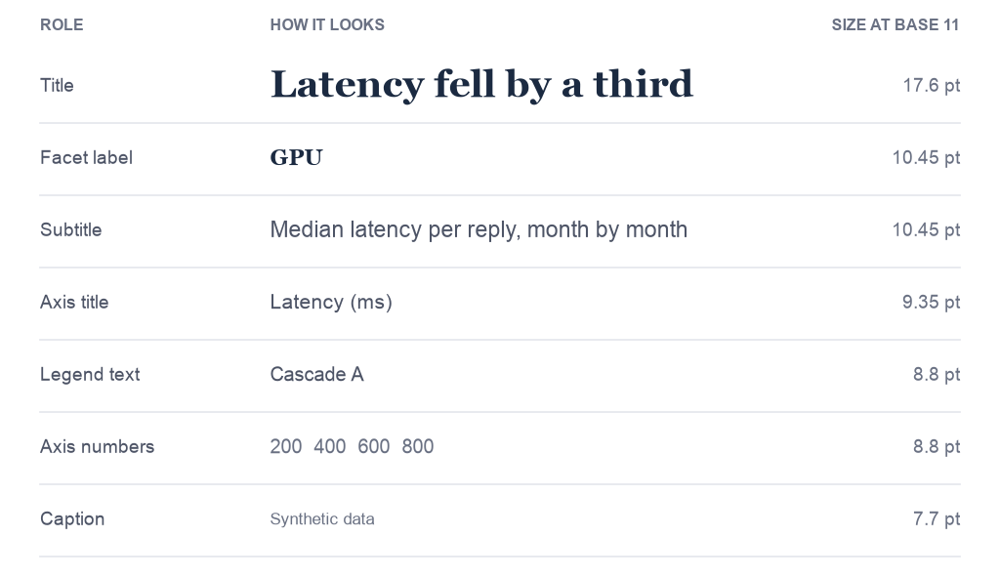
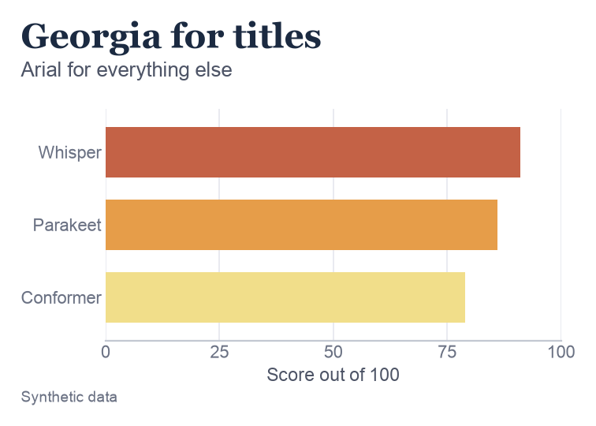
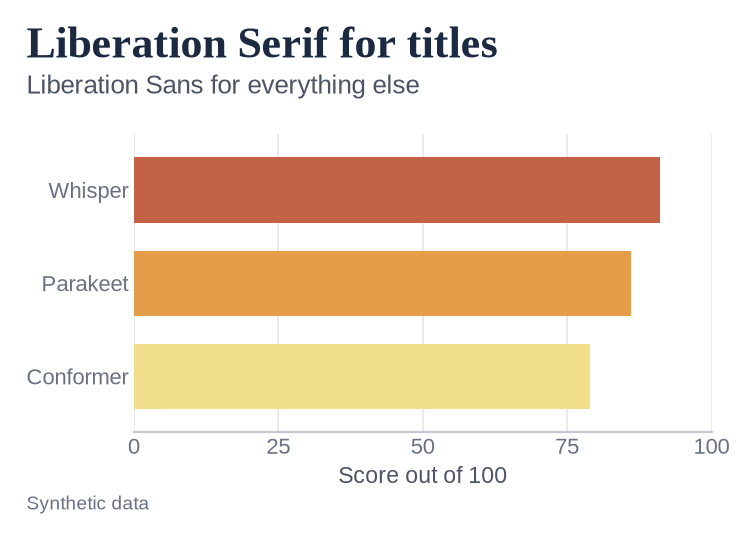
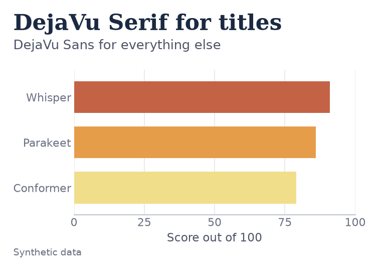
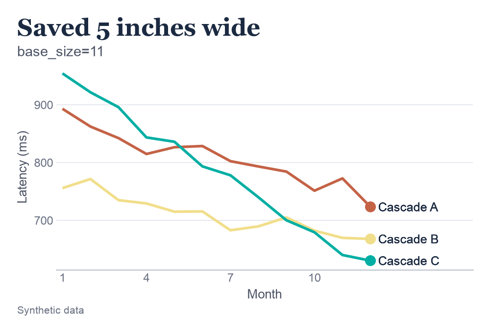
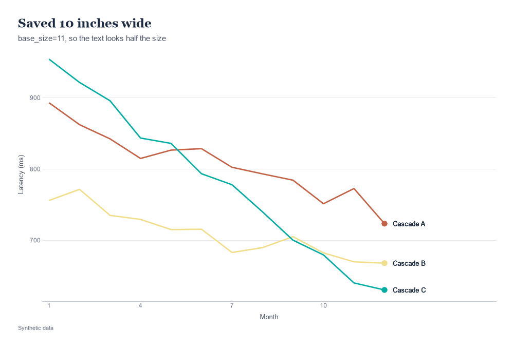
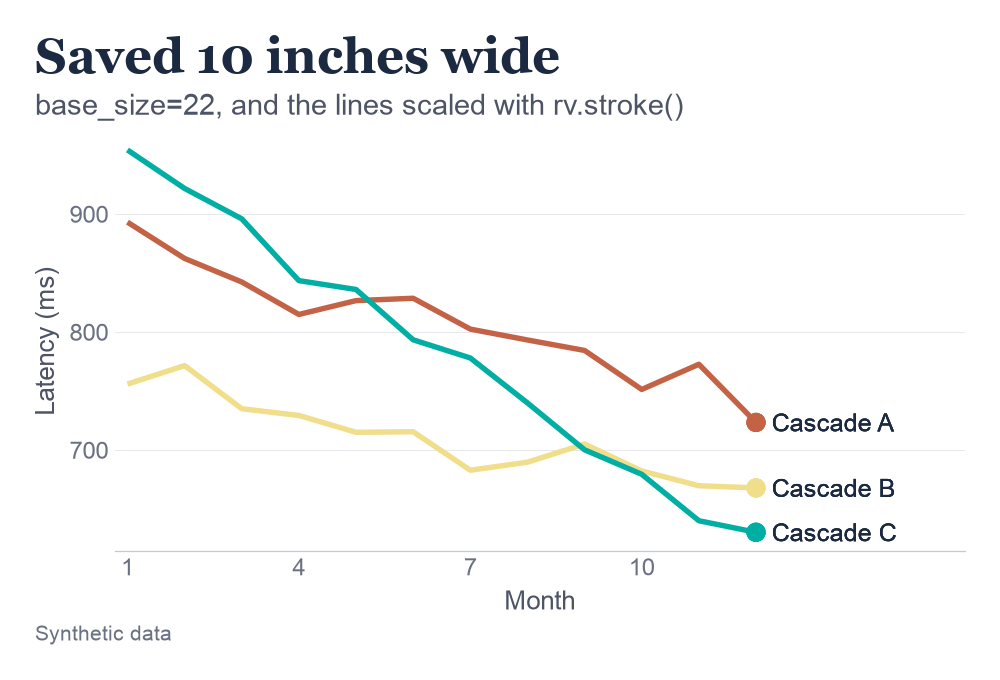
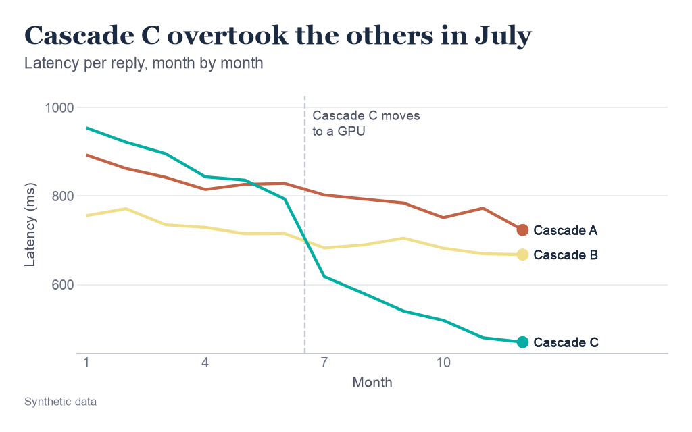

# Fonts and text

Most of what's on a chart, apart from the data, is words: the title, the axis names, the numbers along the axes, the labels on the lines. This page covers which fonts Roygbviz uses for them, how big they are, and how to change both.

A few terms first:

- **Typeface** or **font.** The design of the letters, like Arial or Georgia. People use the two words interchangeably, and so do I.
- **Serif.** A font with small strokes at the ends of the letters, like Georgia. A **sans serif** font, like Arial, has none.
- **Point (pt).** The unit for text size. 72 points make an inch, so 11 pt is about the size of ordinary printed text.
- **Base size.** The one text size the rest are worked out from. In Roygbviz it's 11 pt unless you change it.

---

## Two fonts, one job each

<picture>
  <source media="(prefers-color-scheme: dark)" srcset="assets/fonts/scale_dark.png">
  
</picture>

**What it is.** Roygbviz uses two fonts. A serif goes on the title and the panel labels, the text you read first. A plain sans serif goes on everything else, the text you look things up in.

**How to read this one.** Each row is one kind of text, written the way it appears on a chart. The right-hand column gives its size when the base size is 11. The title is the biggest and darkest. Everything below it gets smaller and paler as it gets less important, down to the caption, which you'd only read if you went looking.

**Why two fonts.** The serif title makes a chart look finished, and it's the only thing on the chart in that font, so the eye lands there first. Numbers and labels are easier to read quickly in a plain sans serif, especially when they're small.

---

## Which fonts you'll get

<div class="figure-grid">
<picture><source media="(prefers-color-scheme: dark)" srcset="assets/fonts/pair1_dark.png"></picture>
<picture><source media="(prefers-color-scheme: dark)" srcset="assets/fonts/pair2_dark.png"></picture>
<picture><source media="(prefers-color-scheme: dark)" srcset="assets/fonts/pair3_dark.png"></picture>
</div>

**What it does.** Roygbviz doesn't ship any fonts. It looks through a list, in order, and uses the first one installed on your computer. That way you never get a missing-font warning, but your charts can look a bit different from mine.

| Text | Tries, in order |
|---|---|
| Everything except titles | Inter, Helvetica Neue, Helvetica, Arial, Liberation Sans, DejaVu Sans |
| Titles and panel labels | Source Serif 4, Georgia, Iowan Old Style, Palatino, TeX Gyre Pagella, Caladea, Liberation Serif, DejaVu Serif |

**How to read this one.** The same chart three times, each with a different pair of fonts from those lists. Each title names the font it's written in. They all work. The DejaVu pair, the last resort, is noticeably wider, so long labels take more room.

**In practice.** On Windows you'll usually get Arial and Georgia. On a Mac, Helvetica Neue and Georgia. On Linux it depends what's installed, and Liberation or DejaVu is common. My computer doesn't have Inter, so every figure on this wiki uses Arial and Georgia.

To see which fonts you've got:

```python
from roygbviz.config import pick_font, pick_serif

print(pick_font(), pick_serif())   # Arial Georgia, on my computer
```

---

## Installing the fonts I designed it for

Inter and Source Serif 4 are both free. Install the **static** files, the ones with a separate file for each weight. matplotlib can't pick the bold out of a **variable** font (one file that holds every weight), so with only the variable file your titles come out in plain weight, with a `Failed to find font weight bold` warning.

<div class="os-tabs" markdown="1">

### Linux

```fish
sudo pacman -S inter-font adobe-source-serif-fonts
```

These are the Arch package names, and both include the static files. On other Linux systems, use the Windows instructions and copy the files into `~/.local/share/fonts`.

### macOS

```bash
brew install --cask font-inter
```

That gives you Inter. Homebrew's Source Serif 4 is only the variable file, so get it from the [Source Serif releases](https://github.com/adobe-fonts/source-serif/releases) instead: download the `Desktop` zip, open the `OTF` folder, select every file and double-click to install.

### Windows

1. Download `Inter-4.1.zip` (or newer) from the [Inter releases](https://github.com/rsms/inter/releases). Right-click `Inter.ttc` and choose **Install for all users**.
2. Download the `Desktop` zip from the [Source Serif releases](https://github.com/adobe-fonts/source-serif/releases). Open the `OTF` folder, select every file, right-click and choose **Install for all users**.

</div>

**Then clear matplotlib's font list.** matplotlib keeps a list of your fonts and doesn't notice new ones by itself. Run this once, then restart Python (in Jupyter, restart the kernel):

```python
import pathlib, matplotlib

for f in pathlib.Path(matplotlib.get_cachedir()).glob("fontlist-*.json"):
    f.unlink()
```

Roygbviz picks its fonts once per session, which is the other reason for the restart.

---

## Using your own fonts

`rv.use()` has no font setting, so set the theme yourself straight after it. Any font installed on your computer works, by the name your computer lists it under:

```python
import matplotlib as mpl
from plotnine import theme_set

rv.use("light")
theme_set(rv.theme_roygbviz(base_family="Atkinson Hyperlegible",
                            title_family="Merriweather"))

# For text you add with geom_text(), and for plain matplotlib
mpl.rcParams["font.family"] = "Atkinson Hyperlegible"
```

`base_family` is for everything except titles, and `title_family` is for titles and panel labels. Use the same font for both if you'd rather not have a serif.

**Be careful with:**

- **Spelling.** A name matplotlib can't find gives `findfont: Font family 'Merriweather' not found.` and falls back to DejaVu Sans.
- **The base size.** `rv.theme_roygbviz()` starts from 11 pt, even if you set a different size in `rv.use()`. Pass `base_size=` again if you changed it.
- **A journal's rules.** Some journals ask for a particular font in figures. Check their guidelines before you send them anything.

---

## Text size

<div class="figure-grid">
<picture><source media="(prefers-color-scheme: dark)" srcset="assets/fonts/size1_dark.png"></picture>
<picture><source media="(prefers-color-scheme: dark)" srcset="assets/fonts/size2_dark.png"></picture>
<picture><source media="(prefers-color-scheme: dark)" srcset="assets/fonts/size3_dark.png"></picture>
</div>

**What it is.** Text on a chart has a fixed size in points, however big the chart is. So the size you save a chart at decides how big the text looks once it's on the page.

**How to read this one.** The same chart, saved three ways and shown at the same width, as it would be in a document. The first was saved 5 inches wide. The second was saved 10 inches wide, so once it's shrunk to fit, everything looks half the size: the text is hard to read and the lines are thin. The third is also 10 inches wide, but with the base size doubled to 22, and it looks just like the first.

**Using it.** The easiest fix is to save the chart at the size it'll be printed. When you can't, change the base size in `rv.use()`, and every piece of text in the theme grows with it. Lines and points don't follow the theme, so wrap their sizes in `rv.stroke()`, which scales them by the same amount:

```python
rv.use("light", base_size=22)

(ggplot(d, aes("month", "ms", colour="cascade"))
 + geom_line(size=rv.stroke(1.1))
 + rv.end_labels(d, "month", "ms", "cascade", size=rv.stroke(3.4), text_size=rv.stroke(9)))
```

`rv.end_labels()` doesn't follow the base size either, which is why its sizes are wrapped too.

**Be careful with:** very small text. At the default base size, the caption is 7.7 pt and the axis numbers 8.8 pt. If your chart will be shrunk to fit a column, check those are still readable once it's in place.

---

## Text inside the chart

<picture>
  <source media="(prefers-color-scheme: dark)" srcset="assets/fonts/labels_dark.png">
  
</picture>

**What it is.** Words placed on the chart itself, next to the data they're about, instead of in a legend off to the side. The reader doesn't have to look back and forth to match colours to names.

**How to read this one.** Each line is a cascade's latency, month by month, and lower is faster. Cascade C starts as the slowest. In July (the dashed line) it moves to a GPU, and the note says so right where it happens. From then on its line drops below the other two, which is what the title says.

**Using it.** `rv.end_labels()` names each line at its end. For notes, use `annotate("text", ...)`, or `geom_text()` for a label on every row of your data. Their `size` is in points, the same as the theme.

```python
pal = rv.use("dark")

(ggplot(d, aes("month", "ms", colour="cascade"))
 + geom_line()
 + annotate("text", x=6.7, y=1000, label="Cascade C moves\nto a GPU", ha="left", va="top",
            size=8.5, colour=pal.neutrals["text_2"])
 + rv.end_labels(d, "month", "ms", "cascade"))
```

**Be careful with:**

- **Dark mode.** Text you add with `geom_text()` or `annotate()` is black unless you say otherwise, and black text vanishes on navy paper. Always pass a colour from `pal.neutrals`: `"text"` for the main ink, `"text_2"` for softer notes, and `"muted"` for the faintest.
- **Coloured text.** Writing a label in its line's colour seems neat, but the pale colours are too faint to read as text. `rv.end_labels()` writes in ink for that reason. The [Colour page](colour.md#contrast) has the numbers.
- **Crowding.** If labels pile on top of each other, label fewer things. A note on the one point that matters does more than a label on every point.

---

## Titles that say something

The title is the biggest text on the chart, so I use it for the finding: "Cascade C overtook the others in July", rather than "Latency by month". The subtitle then says what's being measured, with units, and the caption says where the data came from.

```python
+ labs(title="Cascade C overtook the others in July",
       subtitle="Latency per reply, month by month",
       caption="Synthetic data")
```

Leave the title off when the chart goes into a paper with a figure caption underneath, since journals usually want the title there instead. The [Anatomy of a figure](anatomy.md) page names every part of a chart.

---

## In plain matplotlib

`rv.use()` sets matplotlib's fonts and sizes too, with one difference: matplotlib titles are in the body font, in bold, not the serif. Ask for the serif when you set the title:

```python
import matplotlib.pyplot as plt
from roygbviz.config import pick_serif

rv.use("light")
fig, ax = plt.subplots()
ax.set_title("Cascade C overtook the others in July", family=pick_serif())
```

In matplotlib the title is 1.3 times the base size, axis titles 0.9 and the axis numbers 0.8, so 14.3, 9.9 and 8.8 pt at the default.

---

<small>The figures on this page are made by [`scripts/fonts.py`](https://github.com/KhaiShea/roygbviz-wiki/blob/main/scripts/fonts.py). [Inter](https://rsms.me/inter/) is by Rasmus Andersson and [Source Serif](https://github.com/adobe-fonts/source-serif) by Frank Grießhammer for Adobe, both under the SIL Open Font License.</small>
