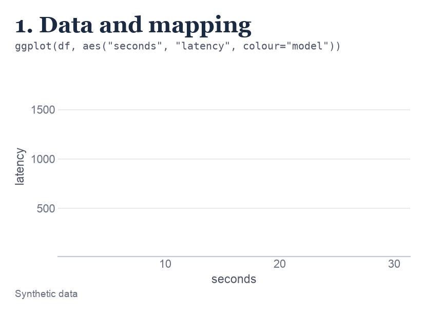
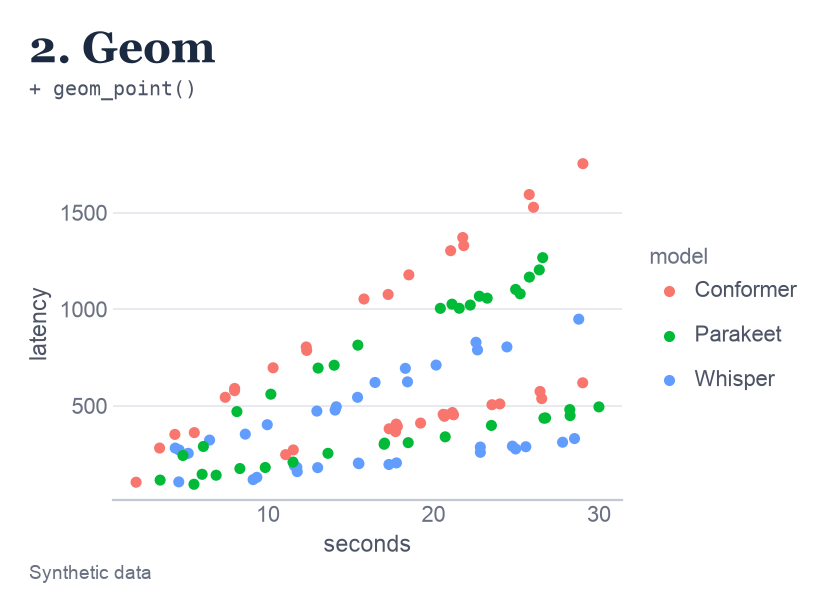
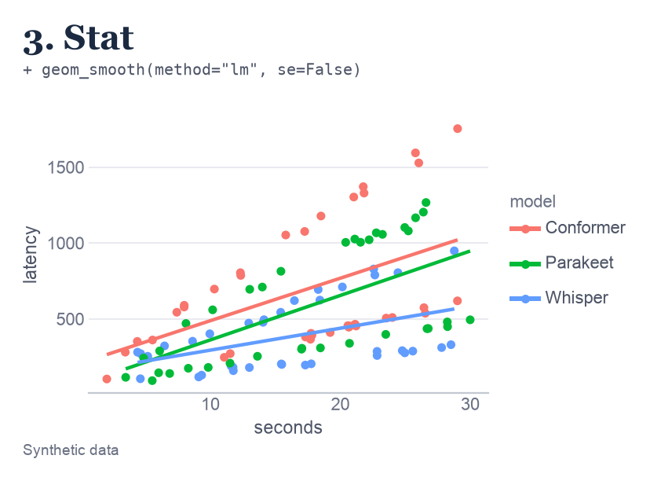
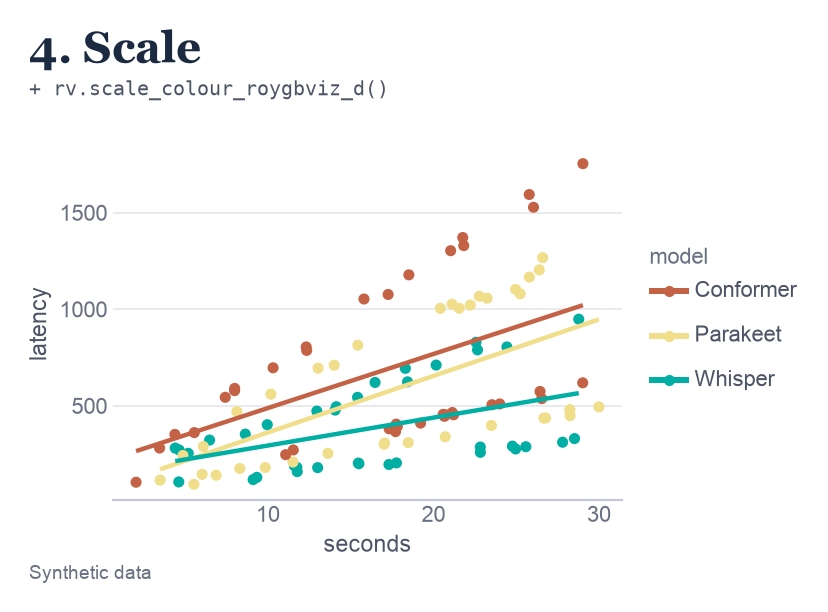
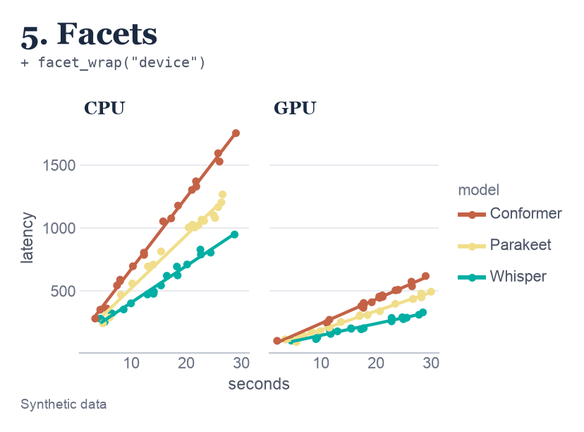
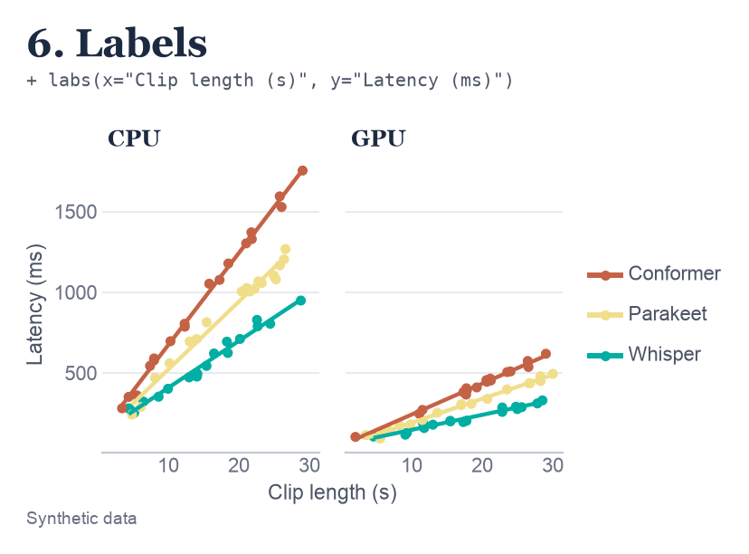
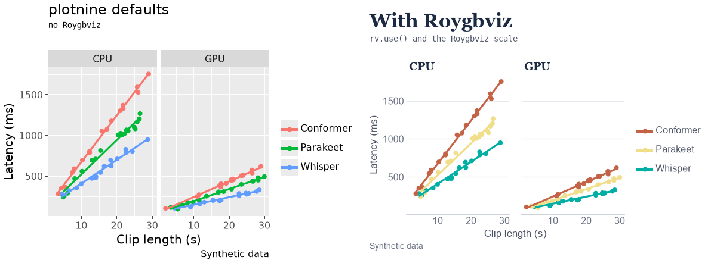

# Grammar of graphics

plotnine has no "bar chart" function and no "scatter plot" function. Instead, you describe a chart in parts: the data, which columns control what you see, and what to draw. plotnine puts the parts together. Once you can see the parts, every chart in this wiki reads the same way.

Think of describing a chart to a friend over the phone: "Put clip length along the bottom and latency up the side. Draw a dot for every recording, and colour the dots by model." Each part of that sentence is one part of the grammar. plotnine just wants the same sentence, written in code.

If you already know ggplot2, skip to [where Roygbviz fits](#where-roygbviz-fits).

---

## Where the idea comes from

Leland Wilkinson set out the grammar of graphics in his book [*The Grammar of Graphics*](https://link.springer.com/book/10.1007/0-387-28695-0). Hadley Wickham turned it into a layered version, described in [A layered grammar of graphics](https://vita.had.co.nz/papers/layered-grammar.html), and built ggplot2 for R on it. [plotnine](https://github.com/has2k1/plotnine), by Hassan Kibirige, brings ggplot2 to Python.

So if you know ggplot2, you mostly know plotnine. The function names are the same. The main differences are that column names go in quotes, and the whole chart sits inside brackets so Python lets it run over several lines.

---

## The parts

An **aesthetic** is any visual property of a mark: its x and y position, colour, fill, size, shape, transparency (`alpha`) or line type. Most of the grammar is about deciding which aesthetics come from your data.

The last column ties each part to the example chart further down the page.

| Part | What it decides | In plotnine | In the example |
|---|---|---|---|
| **Data** | The table you're plotting, one row per observation | `ggplot(df, ...)` | 108 recordings, each with its clip length, latency, model and hardware |
| **Mapping** | Which column controls which aesthetic | `aes("x", "y", colour="model")` | Clip length goes across, latency goes up, and the model sets the colour |
| **Geom** | The shape drawn for each row | `geom_point()`, `geom_line()`, `geom_col()` | A dot for every recording |
| **Stat** | A calculation on the data before drawing, like counting or fitting a line | `geom_smooth()`, `geom_histogram()` | A straight line fitted through each model's dots |
| **Scale** | How values turn into positions, colours and sizes | `scale_y_log10()`, `rv.scale_colour_roygbviz_d()` | Roygbviz's colours for the three models |
| **Coordinates** | The space the chart is drawn in | `coord_flip()`, `coord_fixed()` | Ordinary across and up. It's the default, so it isn't in the code |
| **Facets** | Splitting the chart into small panels, one per group | `facet_wrap("device")` | One panel for CPU and one for GPU |
| **Theme** | Everything that isn't data: background, fonts, grid | `rv.theme_roygbviz()`, `theme(...)` | Roygbviz's paper, fonts and hairline grid |

Labels sit alongside these. `labs()` sets the title, axis names and caption.

---

## Build a chart one part at a time

Here's one chart built up a step at a time. It asks a practical question: when a speech-to-text model has a longer recording to transcribe, how much longer does it take? There are three models, each run on two kinds of hardware: an ordinary processor (CPU) and a graphics card (GPU), which is built for this kind of work. Latency is how long the model took, in milliseconds.

<div class="figure-grid cols-2">
<picture><source media="(prefers-color-scheme: dark)" srcset="assets/grammar/step1_dark.png"></picture>
<picture><source media="(prefers-color-scheme: dark)" srcset="assets/grammar/step2_dark.png"></picture>
<picture><source media="(prefers-color-scheme: dark)" srcset="assets/grammar/step3_dark.png"></picture>
<picture><source media="(prefers-color-scheme: dark)" srcset="assets/grammar/step4_dark.png"></picture>
<picture><source media="(prefers-color-scheme: dark)" srcset="assets/grammar/step5_dark.png"></picture>
<picture><source media="(prefers-color-scheme: dark)" srcset="assets/grammar/step6_dark.png"></picture>
</div>

And here's the finished code:

```python
import roygbviz as rv
from plotnine import aes, facet_wrap, geom_point, geom_smooth, ggplot, labs

rv.use("light")

(ggplot(df, aes("seconds", "latency", colour="model"))
 + geom_point()
 + geom_smooth(method="lm", se=False)
 + rv.scale_colour_roygbviz_d()
 + facet_wrap("device")
 + labs(x="Clip length (s)", y="Latency (ms)", colour="", caption="Synthetic data"))
```

What each step did:

1. **Data and mapping.** We've told plotnine which data to use and which column goes where, but not what to draw. So it sets up the axes with the right ranges and leaves the space empty.
2. **Geom.** Now there's a dot for every recording. Dots further right were longer clips, and dots higher up took longer. The colours are plotnine's own defaults, because we haven't chosen any yet.
3. **Stat.** `geom_smooth(method="lm")` works out the straight line that best fits each model's dots, and draws that line. A steeper line means the model slows down more for every extra second of audio. It picked up `colour="model"` from the mapping, so it fitted one line per model without being asked.
4. **Scale.** Swapping in the Roygbviz scale changes the colours and nothing else. Same data, same shapes.
5. **Facets.** One panel per kind of hardware. This is the step that changes the story. Until now, each line mixed fast GPU runs with slow CPU runs, so the dots were scattered and Parakeet and Conformer looked about the same. Split apart, every line is tight, and Conformer is clearly the slowest on both.
6. **Labels.** Axis names a reader can understand, instead of the column names from the data.

**How to read the finished chart.** Look at the CPU panel first. Every line climbs, so longer clips always take longer. Conformer's line is the steepest: a 30-second clip takes it about 1,810 ms, against about 990 ms for Whisper. Now look across at the GPU panel. The same three lines are much flatter, and the same 30-second clip takes Whisper only about 330 ms. So the GPU makes every model faster, and the order of the models stays the same.

The theme came from `rv.use()` the whole way through. The data is synthetic, and [`scripts/grammar.py`](https://github.com/KhaiShea/roygbviz-wiki/blob/main/scripts/grammar.py) shows how it was made.

---

## Mapping or setting

There are two ways to give a mark a colour, and they're easy to mix up. Mapping means "let the data decide". Setting means "I'll decide".

- **Mapping** goes inside `aes()` and names a column. Each value in the column gets its own colour.
- **Setting** goes outside `aes()` and gives one fixed value to every mark.

```python
geom_point(aes(colour="model"))       # mapping: each model gets its own colour
geom_point(colour=rv.colour("teal"))  # setting: every point is teal
```

The classic mistake is `geom_point(colour="model")`. That fails with `ValueError: Unknown name 'model' for a color`, because plotnine reads `"model"` as the name of a colour.

A mapping inside `ggplot()` is shared by every layer. A mapping inside one geom only applies to that layer.

---

## The order of the pieces

You add pieces with `+`, and for the most part the order doesn't matter. A **layer** is one thing drawn on the chart, like the dots or the lines. Layers stack up like sheets of tracing paper, one on top of the next.

Three times the order does matter:

- **Layers draw in the order you add them.** Later ones go on top. In the chart above, the lines sit over the points because `geom_smooth()` comes after `geom_point()`.
- **A second scale for the same aesthetic replaces the first.** plotnine warns you: `Scale for 'color' is already present. Adding another scale for 'color', which will replace the existing scale.`
- **A full theme replaces everything before it.** `rv.theme_roygbviz()` is a full theme, while `theme(...)` only tweaks one. So tweaks go after:

```python
+ rv.theme_roygbviz(grid="xy") + theme(legend_position="top")   # the tweak sticks
+ theme(legend_position="top") + rv.theme_roygbviz(grid="xy")   # the tweak is lost
```

---

## Where Roygbviz fits

Roygbviz only supplies a few of the parts:

| Grammar part | Roygbviz |
|---|---|
| Theme | `rv.theme_roygbviz()`, which `rv.use()` sets for the whole session |
| Scales | `rv.scale_colour_roygbviz_d()` and `rv.scale_fill_roygbviz_d()` for groups, the `_c` versions for magnitude, `_div` for above and below a midpoint, and `_groups` for STT, LLM and TTS |
| Layers | `rv.end_labels()`, which adds a layer of dots and a layer of names |
| Position scale | `rv.room()`, an x scale with extra space on the right for those names |

Everything else (data, mapping, geoms, stats, coordinates and facets) is plain plotnine. That means any plotnine or ggplot2 tutorial works with Roygbviz. Add `rv.use()` at the top and use a Roygbviz scale for colour.

Here's the finished chart from above with plotnine's defaults, and then with Roygbviz. The data and the shapes are identical. Only the theme and the colour scale differ:

<picture>
  <source media="(prefers-color-scheme: dark)" srcset="assets/grammar/before_after_dark.png">
  
</picture>

- **The background.** plotnine draws each panel on a grey box. Roygbviz puts the data straight onto the paper, so there's less to look past.
- **The gridlines.** plotnine's white grid crosses both ways. Roygbviz uses faint lines in one direction, just enough to read a value off the axis.
- **The colours.** plotnine's three are bright and evenly spaced. Roygbviz's are softer, and each model would keep the same colour in every other figure too.

---

## When plotnine can't draw it

plotnine has no polar coordinates and no 3D, and it isn't built for showing images. For those, I use plain matplotlib, which `rv.use()` styles as well. The [plot type reference](plot-types/index.md) shows how for each one.

---

## Further reading

- [A layered grammar of graphics](https://vita.had.co.nz/papers/layered-grammar.html), Hadley Wickham's paper. Short and readable.
- [ggplot2: Elegant Graphics for Data Analysis](https://ggplot2-book.org/), the ggplot2 book, free online. The examples are in R, but the ideas carry straight over.
- [The plotnine reference](https://plotnine.org/reference/), for every geom, stat, scale and theme setting.
