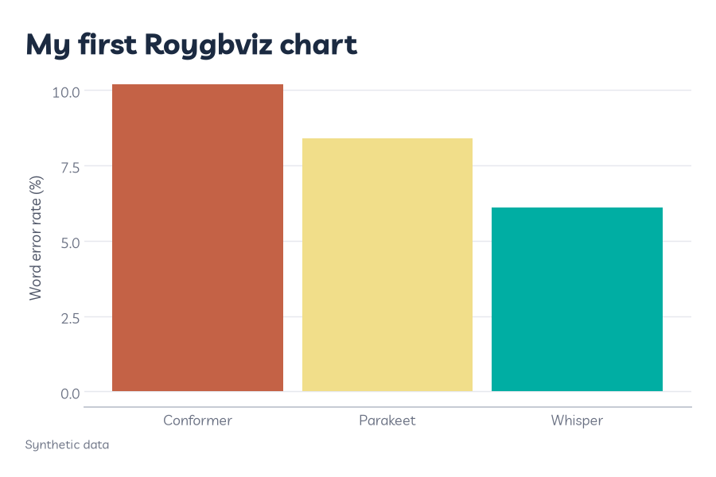
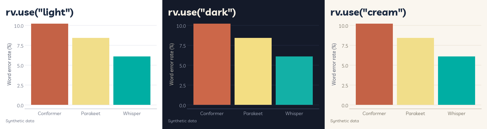

# Setup

This page gets Roygbviz installed in a virtual environment, walks you through your first chart, and shows you the three modes. If anything goes wrong, [troubleshooting](#troubleshooting) at the bottom covers the problems you're most likely to hit.

Two terms first:

- **Virtual environment (venv).** A folder that holds the Python packages for one project, kept apart from the rest of your computer. You switch it on, or **activate** it, in each terminal you use.
- **pip.** Python's package installer. Inside an active venv, `pip install` only touches that venv.

---

## What you need

- **Python 3.10 or newer.** Check with `python --version`. On macOS it's `python3 --version`, and on Windows it's `py --version`.
- **A terminal.**

That's all. pip brings in everything else for you, including plotnine, matplotlib, pandas and NumPy.

---

## Make a virtual environment

On Arch, and with Homebrew's Python on macOS, a plain `pip install` stops with `error: externally-managed-environment`. That's deliberate: it keeps pip from fighting your system's package manager. Giving each project its own venv gets around it, and it means upgrading packages for one project can't break another.

Pick your system. Each set of commands makes a project folder called `my-figures` with a `.venv` folder inside it.

<div class="os-tabs" markdown="1">

### Linux

```fish
sudo pacman -S python
mkdir my-figures; cd my-figures
python -m venv .venv
source .venv/bin/activate.fish
```

These are for Arch with fish. In bash or zsh, the last line is `source .venv/bin/activate` instead.

### macOS

```bash
brew install python
mkdir my-figures && cd my-figures
python3 -m venv .venv
source .venv/bin/activate
```

No Homebrew? The installer from [python.org](https://www.python.org/downloads/) works just as well.

### Windows

```powershell
mkdir my-figures; cd my-figures
py -m venv .venv
.venv\Scripts\Activate.ps1
```

Install Python from [python.org](https://www.python.org/downloads/) first, then run these in PowerShell. In Command Prompt, the last line is `.venv\Scripts\activate.bat` instead. If PowerShell refuses to run the script, see [troubleshooting](#powershell-says-running-scripts-is-disabled).

</div>

### Once it's active

Your prompt starts with `(.venv)`. Type `deactivate` to switch it off. A new terminal always starts without it, so activate it again whenever you come back to the project.

**Using uv?** `uv venv` and then `uv pip install roygbviz` does the same job, just faster.

---

## Install Roygbviz

With the venv active, this is the same on every system:

```bash
pip install roygbviz
```

To check it worked:

```bash
python -c "import roygbviz; print(roygbviz.__version__)"
```

That should print `0.1.1`.

### Other ways to install

If you want the latest code from GitHub before it reaches PyPI (you'll need git):

```bash
pip install git+https://github.com/KhaiShea/roygbviz.git
```

If you want to change the library itself, clone it, make a venv inside the clone, and do an **editable install**. That way your edits take effect straight away, without reinstalling:

```bash
git clone https://github.com/KhaiShea/roygbviz.git
cd roygbviz
pip install -e ".[dev]"
pytest
```

The `[dev]` part adds pytest, Pillow and the build tools. Every test should pass.

---

## Your first chart

Save this as `first_chart.py` in your project folder:

```python
import pandas as pd
from plotnine import aes, geom_col, ggplot, labs

import roygbviz as rv

rv.use("light")

df = pd.DataFrame({
    "model": ["Whisper", "Parakeet", "Conformer"],
    "wer": [6.1, 8.4, 10.2],
})

p = (ggplot(df, aes("model", "wer", fill="model"))
     + geom_col(show_legend=False)
     + rv.scale_fill_roygbviz_d()
     + labs(title="My first Roygbviz chart", x="", y="Word error rate (%)",
            caption="Synthetic data"))

p.save("first_chart.png", width=6, height=4, dpi=150)
```

Run it with `python first_chart.py`. plotnine prints a `PlotnineWarning` saying `Saving 6 x 4 in image`, which is just a note, not a problem (add `verbose=False` to `save()` to hide it). You'll get `first_chart.png` next to the script:

<picture>
  <source media="(prefers-color-scheme: dark)" srcset="assets/setup/first_chart_dark.png">
  
</picture>

Only two lines in there are Roygbviz. `rv.use("light")` styles everything, and `rv.scale_fill_roygbviz_d()` colours the bars. The rest is plain plotnine, which [Grammar of graphics](grammar-of-graphics.md) walks through.

**Want to see it without saving a file?** In a Jupyter notebook, put `p` on the last line of a cell. In a script, `p.show()` opens it in a window.

---

## Light, dark and cream

Roygbviz has three modes. Here's the same chart in each:



| Mode | Paper | I use it for |
|---|---|---|
| `light` | White. This is the default. | Papers and most slides |
| `dark` | Navy | Dark slides, screens and dark-mode websites |
| `cream` | Warm off-white | When I want something softer than white |

Light and cream use exactly the same colours. Only the paper and the greys change. Dark keeps the same hues but moves their lightness so they still sit well on navy.

**Call `rv.use()` before you build the chart.** A chart keeps whichever mode was active when you built it, so calling `rv.use("dark")` afterwards and saving again just gives you the light chart a second time. To get all three, build the chart inside a loop:

```python
def make_chart():
    return (ggplot(df, aes("model", "wer", fill="model"))
            + geom_col(show_legend=False)
            + rv.scale_fill_roygbviz_d())

for mode in ("light", "dark", "cream"):
    rv.use(mode)
    make_chart().save(f"chart_{mode}.png", width=6, height=4, dpi=150)
```

That's how every figure in this wiki is made. The [script for this page](https://github.com/KhaiShea/roygbviz-wiki/blob/main/scripts/setup.py) is a good example.

`rv.use()` also takes a text size and a choice of gridlines. [Customisation](customisation.md) covers those.

---

## Troubleshooting

### `error: externally-managed-environment`

You're installing outside a venv. [Activate it](#make-a-virtual-environment) and run `pip install` again. Don't reach for `--break-system-packages`. It does exactly what it says.

### `ModuleNotFoundError: No module named 'roygbviz'`

Python can't see your venv. Either it isn't active in this terminal, or your editor is running a different Python. In VS Code, open the command palette, run **Python: Select Interpreter**, and pick the one inside `.venv`.

### PowerShell says running scripts is disabled

Windows blocks scripts like `Activate.ps1` by default. To allow scripts you run yourself:

```powershell
Set-ExecutionPolicy -ExecutionPolicy RemoteSigned -Scope CurrentUser
```

### `p.show()` doesn't open a window

You'll also see a warning that `FigureCanvasAgg is non-interactive, and thus cannot be shown`. matplotlib couldn't find a toolkit to draw windows with. On Arch, `sudo pacman -S tk` fixes it. Otherwise, save to a file or use a notebook.

### The fonts look plain

Roygbviz uses the first font it can find from a list:

- **Body text:** Inter, Helvetica Neue, Helvetica, Arial, Liberation Sans, then DejaVu Sans.
- **Titles:** Source Serif 4, Georgia, Iowan Old Style, Palatino, TeX Gyre Pagella, Caladea, Liberation Serif, then DejaVu Serif.

If none of the early ones are installed, you end up with DejaVu, which works but looks plain. To get the intended look, install Inter and Source Serif 4:

- **Arch:** `sudo pacman -S inter-font adobe-source-serif-fonts`
- **macOS:** `brew install --cask font-inter font-source-serif-4`
- **Windows:** download [Inter](https://rsms.me/inter/) and [Source Serif 4](https://fonts.google.com/specimen/Source+Serif+4), then right-click each font file and choose **Install**.

matplotlib keeps a list of fonts and won't notice new ones on its own. Find its cache folder with `python -c "import matplotlib; print(matplotlib.get_cachedir())"`, delete the `fontlist` file in there, and restart Python (or your notebook's kernel). [Fonts and text](fonts-and-text.md) has more.

### My chart stayed light after `rv.use("dark")`

The chart was built before you switched. Call `rv.use()` first, then build the chart. See [light, dark and cream](#light-dark-and-cream).

### `Roygbviz has nine series colours`, or one group comes out grey

There are nine model colours. With more than nine groups, `rv.colour_map()` stops with that error, and the scales warn that they `can return a maximum of 9 values` and draw the extra groups in grey. Fold the smallest groups into one called `"Other"` (it gets grey without using up a colour), or split the chart into small panels with facets.

### `NotImplementedError: the colourblind-safe palette is not built yet`

It isn't built yet, sorry. Leave `colourblind` switched off for now. [Colour](colour.md) covers what I do in the meantime.

### Yellow lines are hard to see

Yellow is the palest of the twelve, so it's faint on white. `rv.scale_colour_roygbviz_d(level=-1)` makes every colour one step deeper, or you can name the lines directly with `rv.end_labels()`. [Colour](colour.md) goes into this properly.
