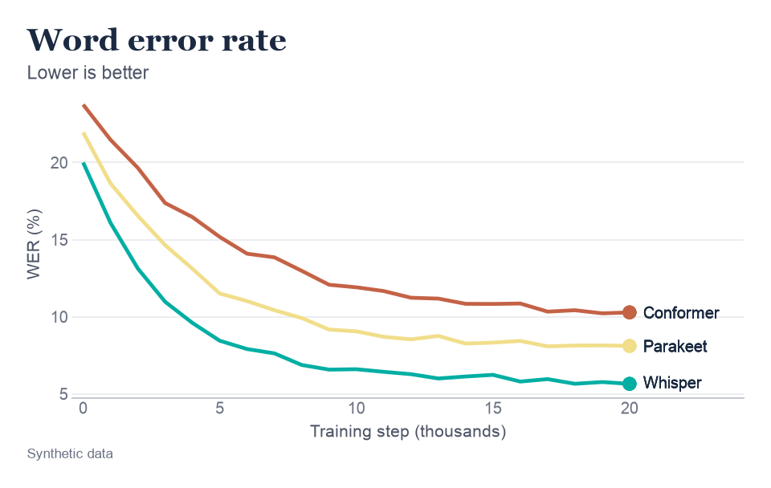

# Start here

Roygbviz (roy-gee-bee-viz) is my theme and colour palette for [plotnine](https://plotnine.org/). I made it because I wanted my research figures to be easy to read, and if I'm honest, I also just wanted them to look nice. This wiki is where I've written down everything I know about using it, for anyone who finds it useful.

<picture>
  <source media="(prefers-color-scheme: dark)" srcset="assets/start-here/taste_dark.png">
  
</picture>

It's on version 0.1.1 on [PyPI](https://pypi.org/project/roygbviz/) right now. That's still alpha, so a few names might change.

---

## Why it exists

I'm writing a research paper on cascaded speech pipelines: speech to text, then a language model, then text to speech, one after the other. I'd like to send it to friends who aren't technical and have them actually follow along.

Figures are the best chance I've got. If someone can read a chart at a glance, it does more for them than another paragraph of methods ever will. So I wanted a few things from mine:

- **The colours should mean something.** Each model keeps the same colour in every figure, and each stage of the pipeline gets its own colour as well.
- **Nobody should have to squint.** I write each line's name at the end of the line, so you're not matching colours against a legend, and I keep the grid and axes quiet.
- **It should look good in any light.** I like serif titles, and I wanted light, dark and cream versions that all share the same colours.

Roygbviz isn't a plotting library, though. plotnine does the drawing, and Roygbviz decides how it looks.

---

## Key terms

You'll see these on nearly every page, so here they are up front. The [glossary](glossary.md) covers the rest.

| Term | What I mean by it |
|---|---|
| **plotnine** | The Python library that draws the charts. Roygbviz is a theme for it. |
| **matplotlib** | What plotnine draws with underneath. Roygbviz styles it too, which helps for the charts plotnine can't draw. |
| **Grammar of graphics** | A way of describing a chart in layers: your data, which columns map to what you see, and the marks that get drawn. It's how plotnine works. |
| **Theme** | Everything on a chart that isn't data, like the background, fonts, gridlines and axes. |
| **Palette** | The set of colours. Roygbviz has twelve. |
| **Scale** | The rule that turns data values into colours (or positions, or sizes). |
| **Mode** | What the figure sits on. `light` is white paper and the default, `dark` is navy, and `cream` is warm paper. |
| **STT, LLM, TTS** | Speech to text, large language model and text to speech. These are the three **stages** of a cascade. |
| **Cascade** | A speech pipeline that runs those three stages one after the other. |
| **Model colours** | The nine colours for series, such as one per model. |
| **Stage colours** | Three colours, one each for STT, LLM and TTS. |
| **Level** | One of five lightness steps of a colour, from deep to soft. The default colour sits in the middle. |
| **End labels** | A line's name written at its right-hand end, so you don't need a legend. |

---

## Which bits to read

### If you just want to read my figures

You don't need to install anything. There are four things worth knowing about the figures in my paper:

- **Same colour, same model.** Once you know a model's colour, it stays that way in every figure.
- **Colour families follow the stages.** The STT models are red, orange and yellow. The LLMs are green, teal and blue, and the TTS models are indigo, violet and pink.
- **Crimson is above, deep blue is below.** That's on charts that show values either side of a baseline. White is the middle.
- **"Synthetic data" means made-up numbers.** If a caption says that, I'm using the chart to show how something works, not to report a result.

After that, I'd read these three pages in order:

1. [Anatomy of a figure](anatomy.md), which names every part of a chart.
2. [Colour](colour.md), but only the first section.
3. [Cascade comparisons](cascade-comparisons.md), which shows the kinds of figures in my paper.

### If you want your figures to look like this

1. [Setup](setup.md) gets it installed and walks you through your first chart.
2. [Grammar of graphics](grammar-of-graphics.md) explains how plotnine thinks. Skip it if you already know ggplot2.
3. [Choosing a plot](choosing-a-plot.md) starts from the question you're asking rather than the chart type.
4. [Colour](colour.md) covers which scale to use, and when.
5. The [plot type reference](plot-types/index.md) has a page for each kind of chart, with code.
6. [Recipes](recipes.md) are there to copy, paste and adjust.

### If you want to change the library itself

1. [Setup](setup.md), for the editable install.
2. [Customisation](customisation.md) goes through every setting the library exposes.
3. [Colour](colour.md) explains how I built the palette, and the `check()` gates it has to pass.
4. The source lives in [`src/roygbviz`](https://github.com/KhaiShea/roygbviz/tree/main/src/roygbviz) in the library repo. Run the tests with `pytest`.
5. [Credits](credits.md) lists the work Roygbviz is built on.

---

## Quick taste

Install it. You'll need Python 3.10 or newer.

```bash
pip install roygbviz
```

Then, if you've got a DataFrame `df` with `step`, `wer` and `model` columns:

```python
import roygbviz as rv
from plotnine import aes, geom_line, ggplot, labs, theme

rv.use("light")  # or "dark", or "cream"

(ggplot(df, aes("step", "wer", colour="model"))
 + geom_line(size=rv.stroke(1.2))
 + rv.end_labels(df, "step", "wer", "model") + rv.room()
 + rv.scale_colour_roygbviz_d()
 + theme(legend_position="none")
 + labs(title="Word error rate", subtitle="Lower is better",
        x="Training step (thousands)", y="WER (%)", caption="Synthetic data"))
```

That's the chart at the top of this page. Here's what each Roygbviz part is doing:

- `rv.use("light")` sets up plotnine's theme, matplotlib's defaults and the Roygbviz colour maps for the rest of the session.
- `rv.stroke(1.2)` ties the line width to the text size. If you shrink a figure to fit a column, the lines shrink with the text and it still looks balanced.
- `rv.end_labels(...)` writes each model's name at the end of its line, and `rv.room()` makes space on the right so the names fit.
- `rv.scale_colour_roygbviz_d()` hands out colours so each new one is as different as possible from the ones already used. Here that's red, then yellow, then teal. In my paper I pin each model to a fixed colour with `rv.colour_map()` instead, so it never changes from one figure to the next.

You'll notice the yellow is pale on white. That's because yellow only looks yellow when it's bright. The end label keeps it readable here, and the [Colour](colour.md) page goes through the other fixes.

The script for this figure, synthetic data and all, is [`scripts/start_here.py`](https://github.com/KhaiShea/roygbviz-kb/blob/main/scripts/start_here.py). It writes a [cream version](assets/start-here/taste_cream.png) too.

---

## How I've built this

Every figure here can be rebuilt. The script that makes it is committed in [`scripts/`](https://github.com/KhaiShea/roygbviz-kb/tree/main/scripts), and all the example data is synthetic. Every chart says so in its caption.

I've checked it against the real code, which right now means Roygbviz 0.1.1 with plotnine 0.15.8. If something here disagrees with the code, trust the code, and please [open an issue](https://github.com/KhaiShea/roygbviz-kb/issues) so I can fix it.

The plot type pages follow the categories in the [matplotlib gallery](https://matplotlib.org/stable/gallery/index.html). I link to the gallery rather than copying it, and the explanations are my own.
